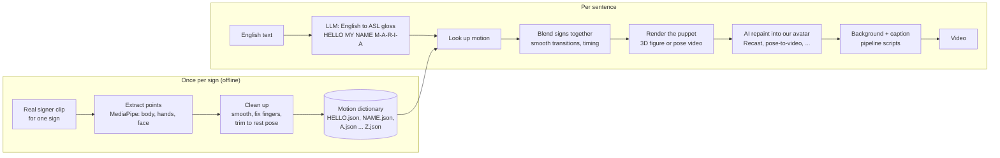

# Sign Avatar · Method B: 3D puppet + AI repaint

**Type a sentence. Get a realistic video of a person signing it in ASL.**

This repo explores **Method B**: store every sign as **motion data** (hand, body and face points), join the motion smoothly for any sentence, drive a simple **3D figure** with it, then let an **AI video model repaint** the figure into our realistic avatar.

**We are building Method B only.** The twin repo, **[sign-avatar-a-stitching](https://github.com/LedionBrati/sign-avatar-a-stitching)** (Method A, join pre-made avatar video clips), stays as a reference. Its Recast-on-real-signer approach is also our **fallback** (see section 4).

> **Status (14 Nov 2026):** the realistic avatar works on real sentences (see the demo below). Method B itself is **untested**: nobody has yet driven a 3D figure from sign data and repainted it. We get there through **4 checkpoints, free ones first** (section 4). Nothing here is assigned to anyone: read, pick what interests you, write down what you learn.

---

## Contents

1. [The vision](#1-the-vision)
2. [What already works](#2-what-already-works)
3. [The one idea everything rests on](#3-the-one-idea-everything-rests-on)
4. [The path: 4 checkpoints](#4-the-path-4-checkpoints)
5. [Method B, explained](#5-method-b-explained)
6. [The hard parts (open problems)](#6-the-hard-parts-open-problems)
7. [Existing pieces we can reuse](#7-existing-pieces-we-can-reuse)
8. [What's in this repo](#8-whats-in-this-repo)
9. [Setup](#9-setup)
10. [The pipeline scripts](#10-the-pipeline-scripts)
11. [fal models cheat sheet](#11-fal-models-cheat-sheet)
12. [How we work together](#12-how-we-work-together)
13. [Rules we don't break](#13-rules-we-dont-break)
14. [Glossary](#14-glossary)
15. [Credits](#15-credits)

---

## 1. The vision

A Deaf person and a hearing person are trying to talk. The hearing person speaks or types. The Deaf person sees a **realistic person signing** what was said, in their language, right away.

Why not just captions? For many Deaf people **ASL is their first language** and English their second. Reading fast captions in a second language is tiring. A signer is easier to follow. Captions stay on screen too, but the signer comes first.

**Step 1 (now):** a localhost app. Type `Hello, my name is Maria`, get a video like [`judy-phone.mp4`](assets/demo/judy-phone.mp4) that signs exactly that.

**Later (ideas, not a plan):**
- speech in instead of typing
- live, during a call (this is where Method B could shine: see 6.8)
- more signs, more avatars, facial grammar under our control
- the other direction: the Deaf person signs, the hearing person hears it (the same motion data can train a recognizer)

---

## 2. What already works

On 14 Nov 2026 we turned a real ASL signer into our AI avatar, frame for frame.

| File | What you'll see |
|---|---|
| [`assets/demo/judy-side-by-side.mp4`](assets/demo/judy-side-by-side.mp4) | Real signer left, our avatar right, same signs, caption below |
| [`assets/demo/judy-phone.mp4`](assets/demo/judy-phone.mp4) | Phone version: avatar full screen, small real-signer window |
| [`assets/demo/judy-avatar-clean.mp4`](assets/demo/judy-avatar-clean.mp4) | Just the avatar on the wall |
| [`assets/demo/judy-real-vs-recast-vs-reference.mp4`](assets/demo/judy-real-vs-recast-vs-reference.mp4) | Real vs the two fal methods we tested |

The full story, numbers, and what failed: **[`docs/findings-2026-11-14.md`](docs/findings-2026-11-14.md)**. Read it before you start.

What matters most for Method B:
- **`minimax/h3-max/recast` copies motion frame for frame** from a video of a **real person**. Whether it does the same from a **3D render** is unknown (checkpoint 3).
- `minimax/h3-max/reference-to-video` **interprets** motion and drifts into wrong signs after a few seconds. A loose motion guide is not enough for sign language.
- Fast fingers were the weak spot even with a real source video. With tracked points, fingers will be harder.

---

## 3. The one idea everything rests on

**AI video models do not know sign language.** They make hands that look like signing but mean nothing.

So:

```
the SIGNS come from real signers          (recorded, then stored as motion data)
the LOOK comes from the AI avatar         (consistent, realistic, nobody's real face)
```

In Method B the motion data is the source of truth. The 3D figure and the AI repaint are only there to make it look human. If the repaint changes a handshape, the sign is wrong, however good it looks.

---

## 4. The path: 4 checkpoints

We prove the hard parts **in order, free ones first**, before building a big vocabulary or spending on AI repaint. Each checkpoint ends with a short demo and an honest **go / no-go** written in `experiments/`.

| # | Checkpoint | Done when | Cost | Details |
|---|---|---|---|---|
| **1** | **Motion proof.** One real signer clip → MediaPipe points (raw + cleaned) → 3D puppet playing in the browser | One clip plays, with 3 views side by side: **real signer \| skeleton \| puppet**. Source, signer, license and timecodes written down. | free | 6.4, 6.7, section 7 |
| **2** | **Finger test.** Check every frame for lost or wrong fingers | A frame-by-frame report: thumb, finger curl and spread, palm direction, wrist. For each failure: was it the **tracking**, the **cleanup**, or the **puppet**? | free | 6.2 |
| **3** | **Repaint.** Turn the puppet video into our realistic avatar | The repaint keeps the signs **clearly better** than the plain puppet, and the extra time and cost is worth it. Agree a small fal budget first. Log request ids, cost, seconds. | paid | 6.1 |
| **4** | **English to signs, end to end.** A tiny shared "plan" (section 6.5) with 2 or 3 checked signs | One hard-coded sentence goes text → plan → motion → puppet (→ repaint) → video. Words we can't sign show up as "can't sign this yet". | free (paid if repainted) | 6.3, 6.5, 6.9 |

Only after these: more signs, an LLM for the gloss, speech input, live.

**Rules for the checkpoints**
- **Look, don't trust.** A puppet that moves nicely is not proof of correct ASL. Compare handshape, palm and wrist with the real signer, side by side.
- **Keep raw data.** Never let smoothing silently delete fast fingerspelling. Keep raw and cleaned tracks.
- **The quality target** stays [`assets/demo/judy-avatar-clean.mp4`](assets/demo/judy-avatar-clean.mp4): Recast on a real signer.

### If checkpoint 3 fails: the fallback

If no model repaints the puppet without damaging the hands, we **don't** show an AI video with wrong signs. We fall back to **Recast on real signer clips** (what made the Judy demo, `examples/judy.sh`):
- keeps the **realistic avatar** and frame-accurate signs
- only works for sentences or signs we have real clips for
- the puppet still runs underneath (checkpoints 1, 2 and 4 are never wasted: the plan, the motion data and the puppet view stay useful for debugging and for live later)

### B vs the clip-stitching approach

| | **A: Clip stitching** ([twin repo](https://github.com/LedionBrati/sign-avatar-a-stitching), reference only) | **B: 3D puppet + repaint** (this repo) |
|---|---|---|
| A sign is stored as | a short **video** of the avatar | **points** (hands, body, face) per frame |
| A sentence is made by | joining video clips | joining points smoothly, rendering a 3D figure, AI repaint |
| Strong at | correct signs, realism, speed at runtime | smooth moves between signs, timing, control, any sentence |
| Weak at | jumps between signs | fingers (tracked points are noisy), unproven repaint, slower per sentence |
| Time per new sentence | seconds | minutes today (the repaint runs every time), unless a fast or live repaint works |

Both share: the avatar (`assets/avatar/`), the reference clips (`references/`), the finishing scripts (`pipeline/`).

### How we score a result

Once B can make a sentence, we compare it with the Judy Recast video (and with the fallback) on the **same 3 sentences**.

Suggested test sentences (change them if you have better ones):
1. `Hello, my name is Maria.` (greeting + fingerspelling: **the finger test**)
2. `Thank you, see you later.` (common signs, two-handed)
3. `Where does it hurt?` (a question: in ASL the eyebrows carry it)

Score each 1 to 5:

| Score | Question |
|---|---|
| **Correct signs** | Would a signer read the right words? (Best judged by a Deaf or fluent signer.) |
| **Smooth** | Natural flow between signs, or jumps and freezes? |
| **Looks real** | Would a friend think it's a real video call? |
| **Speed** | Seconds from pressing enter to the video playing |
| **Cost** | fal spend per new sentence |

Log every comparison in `experiments/`.

---

## 5. Method B, explained

Three layers: **motion** (the truth), **puppet** (a render anyone can check), **repaint** (the realistic look).



### Step by step

1. **Collect** real signer clips (see [`references/README.md`](references/README.md)). Same clips as Method A.
2. **Extract points** from each frame: about 33 body points, 21 per hand, face mesh. Tool: MediaPipe (Holistic, or the newer Pose / Hand / Face Landmarkers).
3. **Clean up**: smooth jitter, fix lost hands, trim each sign to where hands leave and return to rest.
4. **Store** one motion file per sign, named by gloss (`HELLO.json`).
5. **At runtime:** gloss from the LLM, look up each motion, **blend** them (the end of one sign flows into the start of the next), set timing.
6. **Render the puppet**: a 3D figure (for example a VRM model in three.js) or a simple pose video, at the avatar's framing (3:4, waist up).
7. **Repaint** the puppet video into our avatar with an AI model.
8. **Finish** with the same scripts as Method A: background, wall, caption, layouts.

### Why this could beat Method A

- **Smooth transitions for free.** Blending points is easy; blending videos is not.
- **Timing control.** Speed up, slow down, hold a sign, pause between sentences.
- **Facial grammar control.** Raise eyebrows for a question by changing numbers, not by finding a new clip.
- **Tiny storage.** A sign is a few KB of points instead of a video.
- **The puppet is checkable.** Before paying for a repaint, anyone can look at the 3D render and see if the signs are right.

### Why it might fail

- **Fingers.** Tracked finger points are noisy and lose fingers when hands overlap or move fast. Handshape is meaning in ASL.
- **The repaint may not copy precisely.** Day one showed a "motion reference" model drifting. We need a model that copies motion as strictly as Recast did.
- **A cartoon puppet may confuse the repaint model** (does Recast see a 3D character as "a person"?).
- **Slower per sentence**: the repaint runs for every new sentence, unless a fast or live model works.

---

## 6. The hard parts (open problems)

These are **not tasks**. They are the questions this repo needs answered. Pick any, explore it your way, write down what you find in `experiments/`. Each has what we already know and a few ideas to start from. Better ideas are welcome.

### 6.1 The repaint: can an AI copy a puppet's motion exactly? (checkpoint 3)

The realistic look depends on this. If no model repaints a puppet precisely, we use the fallback in section 4. Do it **after** checkpoint 1 gives us a puppet video to repaint.

**Candidates on fal:**
- **`minimax/h3-max/recast`**: copied a real person perfectly on day one. Feed it a **3D render** instead. Does it accept it? Does it keep handshapes?
- **`fal-ai/one-to-all-animation/14b`** (and `/1.3b`): a **pose-driven** model that animates a character from **one reference image**. Made for exactly this: our avatar image + a pose video. Unknown: finger accuracy.
- **`minimax/h3-max/reference-to-video`**: drifted on day one; maybe better with a very clean puppet video as the reference.
- Search fal for more: `pose to video`, `motion transfer`, `character animation`.

**The test:**
1. Take the motion from checkpoint 1 (for example from `references/how2sign/judy.mp4`).
2. Render it two ways, same framing: a **skeleton video** and a **human-shaped puppet** (VRM or mannequin).
3. Repaint both with each candidate, within the agreed budget. Log request id, cost, seconds, and check the frame count matches.
4. Compare fingers, palm and face with the **real signer** and with the Recast result from day one (`assets/demo/judy-avatar-clean.mp4`). Flag any sign part that was added, removed or changed.
5. Go / no-go: is the repaint clearly better than the plain puppet, and worth the extra time and cost?

### 6.2 Getting good finger data (checkpoint 2)

**Known:** MediaPipe gives 21 points per hand. It struggles with fast motion, hands crossing, and hands in front of the face. Even on day one, Recast blurred 1 or 2 frames of fast fingerspelling. Fingers carry meaning in ASL; they are not a cosmetic detail.

**What to check, frame by frame:** thumb position, finger curl, finger spread, palm direction, wrist angle, and fingers bending in impossible ways. Save each frame's confidence/visibility so lost frames are easy to find.

**Where it can break:** the **tracking** (MediaPipe loses a finger), the **cleanup** (smoothing wipes out a quick handshape), the **puppet** (the 3D hand can't make that shape, or body and hand points use different origins). Note which one it was.

**Ideas:**
- Smoothing filters (for example One Euro filter) without killing fast handshape changes.
- Record our own signs at 60 fps with good light; less blur means better tracking.
- Check each sign's handshape automatically (a small classifier) and flag bad frames.
- How2Sign also offers pre-computed keypoints (check its download page). Compare them with MediaPipe.
- Store **joint angles** (finger curl, spread) rather than raw points; easier to blend and fix.

### 6.3 Blending signs together

**Ideas:**
- Blend the last ~0.2 s of one sign into the first ~0.2 s of the next (rotations with slerp, positions with easing).
- Skip the rest pose between signs, like real signers do (co-articulation).
- Keep fingerspelling tight: letters flow with tiny transitions.
- Make timing adjustable per sign (some signs are held, some are quick).

### 6.4 The puppet: what should it look like?

The puppet only has to be readable by the repaint model, not pretty.

**Options to compare:**
- **Skeleton video** (colored lines and dots): what pose models usually expect.
- **VRM 3D character** in three.js: human-shaped, with real fingers. The GSL team repo already does this (see section 7).
- **Neutral mannequin** in the avatar's colors (black top, skin-tone hands, dark wall): may make Recast think "person".
- **Render settings:** match the avatar framing (3:4, waist up, camera at chest height), 24 fps.

### 6.5 English to ASL: the gloss step

Same as Method A. ASL is its own language: `Are you going to the store?` is roughly `STORE YOU GO?` with raised eyebrows.

**The plan: one small format between "English" and "the puppet".** Whatever makes the gloss (hard-coded at first, an LLM later) outputs a **plan**, and everything after it only reads the plan. A suggested shape (a proposal, change it together):

```json
{
  "input_text": "Hello, my name is Maria.",
  "signs": [
    { "gloss": "HELLO", "motion_id": "HELLO", "hold_ms": 0 },
    { "gloss": "MY",    "motion_id": "MY" },
    { "gloss": "NAME",  "motion_id": "NAME" }
  ],
  "fingerspelling": [ { "word": "MARIA", "after_sign": 2 } ],
  "nonmanual_markers": [],
  "unsupported_tokens": [],
  "caption": "Hello, my name is Maria."
}
```

- **`unsupported_tokens`**: words we have no sign for. The app shows "can't sign this yet". We never quietly swap in a different sign, and we only fingerspell on purpose.
- The same plan also drives the fallback (Recast clips), so the app doesn't care which engine renders it.

**Ideas:**
- Start **hard-coded**: 2 or 3 checked signs, one sentence, no LLM. Add the LLM only when that works end to end.
- Then an LLM (Claude) turns English into a plan, **only** using signs in our motion dictionary, marking names for fingerspelling and questions for facial grammar.
- Looking up English words one by one and reordering them is **not** real ASL grammar. Be honest about that in demos.
- A small test set of 20 English sentences + correct plan, checked by a signer.

### 6.6 Facial grammar

In ASL, eyebrows, mouth and head movement are grammar. Method B can **control** them.

**Ideas:**
- Map face points to VRM blendshapes (brows up, brows down, mouth shapes).
- Add question and negation face patterns on top of any sentence.
- Check whether the repaint keeps them (Recast softened expressions a bit on day one).

### 6.7 The motion dictionary format

**Ideas:**
- One JSON per sign: fps, frames, each frame with body, hands, face points (the GSL repo has a clip format to start from).
- Metadata: gloss name, source clip, signer, license, start and end of the actual sign (timecodes in the source), dominant hand, who checked it.
- Keep raw and cleaned versions, so cleanup can be redone.
- **Where the signs come from:** our 4 How2Sign clips are **full sentences**, not single signs. Good for checkpoints 1 and 2, not a dictionary. For single signs, use word-level sources (ASL Signbank, ASL Citizen, WLASL) or record our own. See [`references/README.md`](references/README.md).

### 6.8 Speed, and maybe live

- Points + puppet render can be real time (a browser can do it).
- The repaint is the slow part. fal lists **live video-to-video models** (for example `decart/lucy-2-6/realtime`, over WebRTC). They're not callable through the MCP, only in a real app. If one could repaint a live puppet with good fingers, that's a live signing avatar. Very experimental.

### 6.9 The localhost app

The first thing a user touches. Keep it simple:
- a text box, a "Sign it" button, the video, the gloss under it
- **show the puppet next to the final video**: perfect for debugging which layer broke
- any stack you like

---

## 7. Existing pieces we can reuse

Our hackathon team built a Greek Sign Language app with much of Method B's first half: **`fourlhs/gsl-pharmacy-bridge`** (private, ask Nikos for access). **Check it before building checkpoint 1 from scratch** (see issue #4).

| Its folder | What it does | Useful here for |
|---|---|---|
| `recorder/` | Records signs with a webcam as MediaPipe Holistic points, exports JSON | Building the motion dictionary |
| `avatar/` | Plays recorded points on a **VRM 3D avatar** (three.js + `@pixiv/three-vrm` + kalidokit), with 250 ms blends between signs and a 2D skeleton fallback | The puppet, and blending |
| `recognition/` | Recognizes signs from points (DTW + kNN) | Checking our motion data automatically; the reverse direction later |
| `shared/types.ts` | The clip format: frames with pose, poseWorld, face, leftHand, rightHand | A starting point for our motion format |

Notes from its own docs: finger handshapes come from finger **curl** only (no spread), so some handshapes look approximate; the arm solve is tuned for vtubing. Both matter for ASL.

It's built for **GSL**, not ASL, and a pharmacy vocabulary. The code is language-neutral; only the vocabulary and recordings change.

---

## 8. What's in this repo

```
.
├── README.md                     you are here
├── docs/
│   └── findings-2026-11-14.md    day one: what worked, what failed, numbers
├── assets/
│   ├── avatar/                   the AI woman (3 poses) + empty wall, and how she was made
│   └── demo/                     the Judy demo videos (the quality target)
├── references/
│   ├── README.md                 the clips, their licenses, where to find more
│   └── how2sign/                 4 real ASL sentence clips (judy, travis, dave, floyd)
├── pipeline/                     shared finishing scripts (fal + ffmpeg + headless Chrome)
├── examples/
│   └── judy.sh                   the whole Judy demo (Recast path) in one script
└── experiments/                  everyone's experiment logs (template inside)
```

Method B code (point extraction, blending, puppet rendering, repaint) does not exist yet. Add it as you go, for example `motion/`, `puppet/`, `repaint/`.

`out/` is for your outputs and is ignored by git.

---

## 9. Setup

You need (macOS commands shown):

| Tool | Why | Install |
|---|---|---|
| Node 20+ | fal scripts, caption renderer, likely the puppet (three.js) | `brew install node` |
| ffmpeg + ffprobe | crop, join, composite, encode | `brew install ffmpeg` |
| Google Chrome | renders captions as images; can also render the puppet headless | set `CHROME=/path/to/chrome` if not in `/Applications` |
| A fal API key | repaint models, background removal | fal.ai dashboard, then `export FAL_KEY=...` |
| Python 3.10+ (optional) | MediaPipe is easiest in Python for batch point extraction | `pip install mediapipe` |

```bash
git clone https://github.com/LedionBrati/sign-avatar-b-puppet.git
cd sign-avatar-b-puppet/pipeline && npm install && cd ..
export FAL_KEY=your_key_here     # never commit it
```

Check the shared scripts without spending anything:

```bash
./pipeline/prepare-clip.sh references/how2sign/travis.mp4 out/test.mp4
node pipeline/render-layers.mjs --out-dir out/layers --text "Hello, my name is Maria."
```

---

## 10. The pipeline scripts

Shared with Method A. All tested on 14 Nov 2026.

| Script | What it does | Paid? |
|---|---|---|
| `prepare-clip.sh <in> <out> [x]` | Crop to 3:4 (540x720), 24 fps, no audio. `x` = left edge of the crop. | no |
| `recast.mjs --video --avatar --out [--resolution] [--seed] [--prompt]` | Swap the person in a video for the avatar, same motion. **Try it on a puppet render.** | yes |
| `remove-bg.mjs --video --out-dir` | Cut the person out: `color.mp4` + `alpha.mp4` | yes |
| `composite.sh <color> <alpha> <wall> <out>` | Person on the wall (`REMOVE_RED=0` if there's no red chair) | no |
| `render-layers.mjs --text --out-dir [--credit --left --right]` | Caption, labels, credit as PNG layers | no |
| `build-videos.sh <avatar> <real> <layers> <prefix> [loops]` | Makes `-side-by-side.mp4` and `-phone.mp4`. Tip: pass the **puppet** video as `<real>` to show puppet vs avatar. | no |

Each fal script prints one JSON line (model, request id, seconds, URL). Paste it into your experiment log.

---

## 11. fal models cheat sheet

| Job | Endpoint | Notes |
|---|---|---|
| Swap the person, keep the motion | `minimax/h3-max/recast` | Perfect on a real person (day one). Untested on a puppet. 5 to 30 s input, no prompt. |
| Animate the avatar from poses | `fal-ai/one-to-all-animation/14b`, `/1.3b` | Pose-driven, one reference image. **Prime candidate for Method B.** Untested. |
| New video from references | `minimax/h3-max/reference-to-video` | Realistic, fast, but drifts. Use `reference_conditions` with the video first. Has start + end image inputs. |
| Live restyle of a video stream | `decart/lucy-2-6/realtime` | WebRTC, real app only (not via MCP). For the live dream. |
| Remove video background | `veed/video-background-removal` | Best hands on day one. `output_codec: h264`. |
| Make or edit avatar images | `google/nano-banana-2.1`, `google/nano-banana-2.1/edit` | Made the avatar and the wall plate |

Tip: fal's MCP tools (in Claude Code) have `recommend_model` and `search_models`, handy for finding new models.

---

## 12. How we work together

We're 3 people. **Nobody is assigned anything.** Each time, each of us picks what to build.

- **Read first:** this README and `docs/findings-2026-11-14.md`.
- **Pick something:** a checkpoint in section 4, an open problem in section 6, a GitHub issue, or your own idea. Checkpoint 1 (the motion proof) unlocks everything else, so it's a good first pick.
- **Already started something locally (or with Codex / ChatGPT)?** Push the branch and link it on the issue, so nobody builds it twice.
- **Say it:** comment on the issue (or open one) so the others know. Two people on the same thing is fine if they try different approaches.
- **Log it:** one file in `experiments/` per experiment (copy `_template.md`). Failures are as useful as wins.
- **Share results:** commit small results to `assets/` or link the fal URL. Big videos stay in `out/`.
- **Branches:** `yourname/what-you-try`, open a PR when it works or when you want eyes on it.
- **Decisions:** when we agree on something, write it in "Decisions" below with the date.
- **Repo A is reference only.** We don't develop there; anything useful from it gets copied here.

### Decisions so far

| Date | Decision |
|---|---|
| 2026-11-14 | Language: **ASL**. Avatar: the AI woman in `assets/avatar/`. |
| 2026-11-14 | Recast is the quality target: whatever B makes is compared with `judy-avatar-clean.mp4`. |
| 2026-11-14 | ~~Try both Method A and Method B, race them, keep the winner.~~ Replaced below. |
| 2026-11-14 | **We build Method B only.** Repo A stays as a reference. |
| 2026-11-14 | Work goes through **4 checkpoints, free ones first**: motion proof, finger test, repaint, end-to-end plan (section 4). From Alex's review in issues #1, #2, #4, #5. |
| 2026-11-14 | If the repaint fails, the fallback is **Recast on real signer clips**, so we keep the realistic avatar. |
| 2026-11-14 | One shared **plan** format between English and the renderer (section 6.5). |

---

## 13. Rules we don't break

- **The AI never invents signs.** Signs come from real signers, through the motion data.
- **No real faces as avatars** without written consent. Never a famous person.
- **Licenses:** How2Sign, Signbank, ASL Citizen are non-commercial. Fine for this private repo and private demos. Not for a paid product. Credit the source when you show anything.
- **No keys in git.** `FAL_KEY` lives in your shell or a local `.env` (ignored).
- **Deaf people decide what's good.** Before we call anything "correct", a Deaf or fluent signer checks it. Matching motion is not the same as correct ASL.
- **Never fake a sign.** If we can't sign a word, we say so ("can't sign this yet"). We never quietly swap in another sign, and never show a nice-looking AI video with wrong hands.
- **Write down where every clip came from:** source, signer, license, timecodes.
- **No personal photos** in this repo (the `photos/` folder is git-ignored on purpose).

---

## 14. Glossary

| Word | Meaning |
|---|---|
| **ASL** | American Sign Language. Its own language, with its own grammar. |
| **Gloss** | Writing signs as English words in CAPS, in ASL order: `STORE YOU GO?` |
| **Fingerspelling** | Spelling a word letter by letter with handshapes (A to Z). Used for names. |
| **Handshape** | The shape of the hand in a sign. Change it and the meaning changes. |
| **Rest pose** | Hands down and relaxed, between signs. |
| **Co-articulation** | How one sign flows into the next in real signing. |
| **Non-manual markers** | Face, eyebrows, mouth, head: grammar in ASL. |
| **Keypoints / landmarks** | The tracked points (joints, fingertips, face) per video frame. |
| **MediaPipe** | Google's free library that finds body, hand and face points in video. |
| **VRM** | A standard 3D character format (used with three.js). |
| **Blendshape** | A named face movement on a 3D character (brows up, mouth open). |
| **Slerp** | Smooth blending between two rotations. |
| **Puppet** | The simple 3D figure or skeleton driven by our motion data. |
| **Repaint** | An AI model turning the puppet video into our realistic avatar. |
| **Recast** | fal's H3 Max model that swaps the person in a video and keeps the motion. |

---

## 15. Credits

- Reference clips: **How2Sign**, Duarte et al., CVPR 2021, https://how2sign.github.io/, CC BY-NC 4.0. Cropped, recast and re-backgrounded by us.
- Avatar: AI-generated with Google Nano Banana 2.1 on fal. Not a real person.
- Video: MiniMax H3 Max Recast and Reference to Video on fal. Background removal by VEED on fal.
- Method B builds on ideas and code from our team's GSL Pharmacy Bridge.
- The 4-checkpoint path, the plan format and the finger test come from Alexandros Nomikos's review (issues #1, #2, #4, #5).
