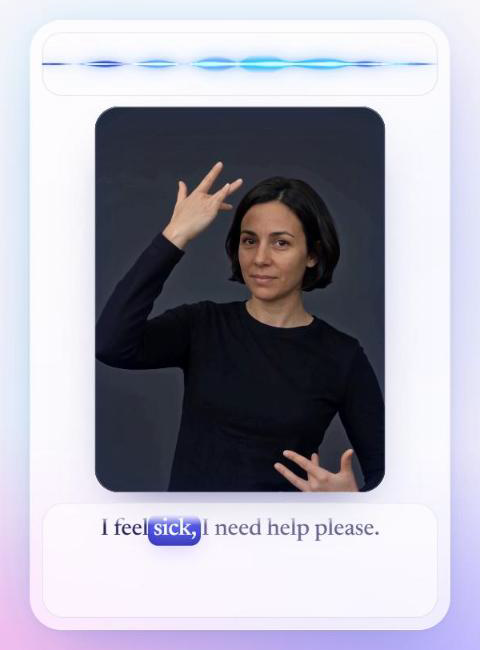
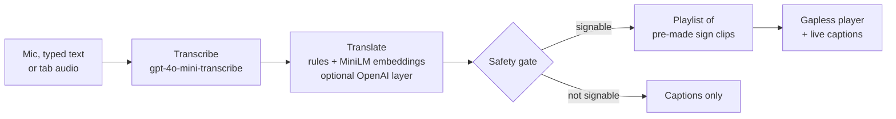
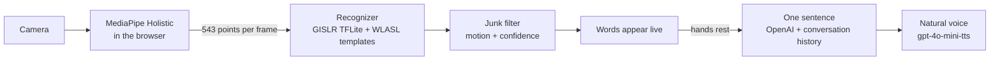
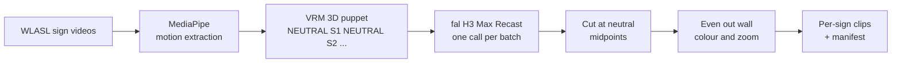

# Flux

**A live sign language interpreter that works both ways.** Speak, and a real-looking signer signs it in ASL. Sign to the camera, and Flux says it out loud.

<p align="center">
  
</p>

## Why it matters

There are about 70 million deaf people in the world, and together they use more than 300 sign languages ([World Federation of the Deaf](https://wfdeaf.org/)). For many of them, a sign language is the first language and written English is the second. Fast captions in a second language are tiring to follow, and most calls, lectures and videos offer nothing else.

Flux puts a signer next to any voice: a person in the room, a YouTube video, a Google Meet call. It also gives signers a voice back, from a phone or laptop camera, with no extra hardware.

## What it does

**Speech to sign**
- Listens to the mic, typed text, or any Chrome tab's audio (YouTube, Google Meet, Zoom web).
- Turns the words into an ASL sign plan in milliseconds, on your own machine.
- Plays a photoreal signer, one sign after another, with no gaps. The first sign starts about 0.2 s after a phrase arrives.
- Shows live captions with the current word highlighted. A word Flux can't sign stays in the captions. It never fakes a sign.

**Sign to voice**
- Tracks hands, body and face with MediaPipe in the browser. Only landmark points leave the device, never video.
- Recognizes 250 signs with a pretrained Kaggle model and 332 more with WLASL motion templates.
- Shows words as you sign them, and filters out transitions and resting hands.
- When your hands rest, writes one natural sentence (using the conversation from both sides) and speaks it in a natural voice.

**Where it runs**
- **Web app:** installable PWA, light frosted-glass design, phone first.
- **Chrome extension:** a floating, draggable glass card over any page, listening to the tab or the mic.
- **Phone app:** built with Expo.
- **Standalone build:** the web app and its clips in one bundle, no server needed (`npm run build:artifact` in `app/web`).

## Quick start

Works the same on Windows (PowerShell or cmd), macOS and Linux.

**1. Install the tools** (once)

| Tool | Why | Windows | macOS |
|---|---|---|---|
| [Node.js](https://nodejs.org) 24 LTS (22.18+ works) | the API, web app and scripts | `winget install OpenJS.NodeJS.LTS` | `brew install node` |
| [uv](https://docs.astral.sh/uv/) | sign to voice (Python recognizer; uv fetches Python 3.13 itself) | `winget install astral-sh.uv` | `brew install uv` |
| Chrome | the web app's camera + speech recognition, the extension | | |
| [ffmpeg](https://ffmpeg.org) *(optional)* | MP4 export of a signed sentence, making new clips | `winget install Gyan.FFmpeg` | `brew install ffmpeg` |

Open a new terminal afterwards so the tools are on your PATH.

**2. Set up and run**

```
git clone https://github.com/LedionBrati/sign-avatar-b-puppet.git
cd sign-avatar-b-puppet
npm run setup
npm start
```

Open **http://localhost:8787/app/**. Type or say a sentence to see it signed; open **Sign** to sign to the camera.

`npm run setup` installs every package, builds the web app, downloads the recognizer models (about 52 MB) and the runtime assets (about 240 MB: sign clips, the 3D signer, recognizer templates; see [Licences and data](#licences-and-data)), and creates `.env`. Re-running it is safe. Options: `--3d` adds the motion library for the instant 3D signer (large), `--ondemand` adds what making new signs with fal needs, `--extension` builds the Chrome extension, `--no-assets` skips the download.

**3. Optional: an OpenAI key.** Without one, Flux needs no paid API: the browser's speech recognition and voice, plus the local translator and recognizer. Put `OPENAI_API_KEY=...` in `.env` to turn on server-side transcription (also needed for tab audio in the extension), natural sentences for sign to voice, the natural voice and the planning layer.

### Configuration

Everything goes in `.env` (created from [`.env.example`](.env.example)); variables already set in your shell win.

| Variable | What it does |
|---|---|
| `OPENAI_API_KEY` (or `OPENAI_API_KEY_FILE`) | Transcription, sentences, voice and the planning layer. Keys are never logged, echoed or returned. |
| `FAL_KEY` (or `FAL_KEY_FILE`), `ONDEMAND=on` | Make missing signs with fal in the background, capped by `FAL_DAILY_BUDGET_USD` (default 20). |
| `HOST`, `PORT` | Where the API listens (default `127.0.0.1:8787`). `HOST=0.0.0.0` to open the app from a phone on the same Wi-Fi. |
| `SIGNING_MODE` | `strict` (default) signs a phrase only when every word is signable; `relaxed` signs what it can and leaves the rest in the captions. |
| `CLIPS_DIR` | Clip folders, comma-separated (default: `clips`, `clips-mass`, `clips-phrases`, `clips-demo` under `out/realtime`); the production sets `out/realtime/clips-v2-*` go in front automatically. |
| `NO_RECOGNIZER=1`, `MOTION=off` | Skip the Python recognizer / the 3D signer. |

The full list is in [`app/server/README.md`](app/server/README.md) and [`app/recognizer/README.md`](app/recognizer/README.md).

### Chrome extension and phone app

- **Extension:** `npm run setup -- --extension`, then open `chrome://extensions`, turn on Developer mode, click **Load unpacked** and pick `app/extension/.output/chrome-mv3`. Click the Flux icon on any tab, choose **Tab** or **Mic**, and press Start. (`npm start` must be running.)
- **Phone:** set `HOST=0.0.0.0` in `.env`, `npm start`, then `cd app/mobile && npm ci && npx expo start` and set the server URL in Settings to `http://<your computer's LAN IP>:8787`.

### Make new signs with fal

Flux generates every sign once, ahead of time ([the clip factory](#the-clip-factory-the-core-idea)). Two ways to add signs:

- **On demand:** `npm run setup -- --ondemand`, then `ONDEMAND=on` and `FAL_KEY=...` in `.env`. A word that has extracted motion but no clip is rendered on the puppet and repainted with fal's H3 Max Recast in the background on first use (about 2 minutes), then hot-loaded into the library.
- **In batches:** `pipeline/produce.mjs` is the production pipeline (render, Recast, cut, even out, QC); see [`pipeline/`](pipeline) and [`experiments/2026-11-15-mass-signs.md`](experiments/2026-11-15-mass-signs.md).

### Development

```
npm run dev     # recognizer + API + the Vite dev server with live reload (http://localhost:5173)
npm test        # every test suite (JS + Python) with one summary; npm test -- server web runs some
```

`cd app/web && npm run dev:mock` runs the web app against a mock API, with no server and no clips. Maintainers publish new runtime assets with `npm run assets:pack` (then upload `dist/assets/*.tar.gz` to the release named in [`scripts/assets.json`](scripts/assets.json)).

## How it works

### Speech to sign



The translator runs locally. Rules go first (about 0.2 ms), then MiniLM embeddings match leftover words by meaning (about 15 ms warm). If a sentence still can't be signed in full, an optional OpenAI layer paraphrases it into signs that exist. Every plan, local or not, passes the same safety gate, and any sign ID that isn't in the library is rejected.

### Sign to voice



The recognizer merges two models. The Kaggle GISLR first-place model knows 250 everyday signs. A template matcher adds 332 signs from WLASL motion we had already extracted, using banded DTW against every template at once. A segment with too little motion or too little confidence is dropped as a transition.

### The clip factory: the core idea

Generating video per sentence takes minutes. Flux generates every sign **once**, as a clip that starts and ends in the same neutral pose. Any sentence is then just clips played back to back.



1. **Extract.** MediaPipe pulls hand, body and face points from a real signer's video.
2. **Puppet.** A three.js VRM puppet re-performs the motion. Signs are batched as `NEUTRAL S1 NEUTRAL S2 ... NEUTRAL`.
3. **Repaint.** One fal H3 Max Recast call turns the whole puppet batch into a photoreal signer. It is frame exact (216 frames in, 216 out), so we know where every sign sits.
4. **Cut.** The video is cut at the middle of each neutral pause. Every clip starts and ends in the same pose, so clips join without a jump.
5. **Even out.** Each Recast job picks its own wall tone and zoom. `pipeline/even-clips.mjs` matches them across jobs, so clips from different batches join cleanly too.

<p align="center">
  
  <br><sub>Joins between clips from different Recast jobs. Top: before. Bottom: after <code>even-clips.mjs</code>.</sub>
</p>

Because the clips are made ahead of time, playback is instant and the video costs nothing per use. Optionally (`ONDEMAND=on`), a missing sign that already has extracted motion is generated in the background on first use and hot-loaded into the library.

## Numbers

Measured during the build on a laptop CPU with no GPU. Details are in [`experiments/`](experiments/).

| | |
|---|---|
| Signs the avatar can sign | **339** |
| Signs the recognizer knows | **250** (GISLR) **+ 332** (WLASL templates) |
| Time to first sign | **about 0.2 s** (a 3 to 4 sign sentence is built in 159 to 186 ms) |
| Text to sign plan | **0.2 ms** with rules, **about 15 ms** with embeddings |
| Recognizer accuracy on unseen WLASL signers | **86% top-1, 96% top-5** (100 clips, GISLR vocabulary) |
| Recognizer round trip | **49 ms** median through the API (30 ms in the model) |
| Template match against the whole bank | **20 to 40 ms** (363 templates) |
| Video cost per use | **$0** (clips are pre-made) |
| fal time to make one sign, once | **about 11 s** |
| New sign on demand, first use to playable | **127 s** (2 signs in one batch) |
| Wall-colour jump at a join between jobs | **18.9 down to 3.6** after evening out |
| Optional OpenAI planning layer | **1.35 s** median, about **$0.001** per sentence |

## Repo map

| Folder | What's in it |
|---|---|
| [`app/server`](app/server) | Node API: sign plans, playlists, clips, transcription, voice, recognizer proxy, on-demand clips |
| [`app/recognizer`](app/recognizer) | Python recognizer: GISLR and fingerspelling TFLite models plus the WLASL template matcher (research scripts in `eval/`) |
| [`app/web`](app/web) | React + Vite web app (PWA) for both directions |
| [`app/extension`](app/extension) | Chrome extension (WXT, Manifest V3): the floating glass card |
| [`app/mobile`](app/mobile) | Expo phone app |
| [`app/core`](app/core) | Shared TypeScript (imported by the server too): API contract, client, captions, vocabulary, landmark layout, design tokens |
| [`translate`](translate) | English to ASL sign plan: rules + local MiniLM embeddings, works offline |
| [`motion`](motion) | MediaPipe motion extraction, cleanup and QA ([`FORMAT.md`](motion/FORMAT.md) is the format) |
| [`puppet`](puppet) | three.js VRM puppet: join signs, play them live, render to mp4 |
| [`pipeline`](pipeline) | The clip factory: batches, Recast, cutting, evening out, mass runs |
| [`shared`](shared), [`catalog`](catalog) | Plan, catalog and motion contracts with their checkers |
| [`docs`](docs) | Day-one findings and the [playback safety gate](docs/semantic-safety.md) |
| [`experiments`](experiments) | Every experiment we ran, with numbers, including the ones that failed |
| [`scripts`](scripts) | `npm run setup`, `test` and the asset packs |
| [`assets`](assets), [`references`](references), [`examples`](examples) | Avatar images, demo videos, reference clips with their licences, demo scripts |

## What's next

- **ASL grammar.** Today the translator produces signed English with ASL-like word order. Next is real ASL grammar, reviewed by Deaf signers.
- **More signs.** 1,831 WLASL signs are already ranked by how often the word is used. Rendering all of them takes about 6.4 h of fal time.
- **Sharper hands.** Rendering at 1080P and half speed turned smeared fast handshapes into readable ones in tests. It at least doubles the fal time per sign.
- **Fingerspelling in live signing.** The recognizer already reads fingerspelled letters (20 of 21 single letters right in a sanity check), but it is not yet part of the live flow.
- **Phones and groups.** Hand tracking that runs natively on phones, and more than one speaker per conversation.

## Team

Built at a hackathon by:

- **Nikos Fourlis** ([@fourlhs](https://github.com/fourlhs))
- **Alex Nomikos** ([@nomikosalex](https://github.com/nomikosalex))
- **Ledi Brati** ([@LedionBrati](https://github.com/LedionBrati))

## Licences and data

**Flux is a research demo for non-commercial use only.** The signer clips are made from datasets with non-commercial licences, so they can't be used in a paid product. The same goes for the runtime assets `npm run setup` downloads (sign clips, motion library, recognizer templates and sign models): they are derived from WLASL and published only for non-commercial research use.

| Source | Used for | Licence |
|---|---|---|
| [WLASL](https://dxli94.github.io/WLASL/) | The sign videos behind every avatar clip and recognizer template | C-UDA, non-commercial research |
| [How2Sign](https://how2sign.github.io/) | Reference sentence clips | CC BY-NC 4.0 |
| [Kaggle GISLR, 1st place](https://huggingface.co/sign/kaggle-asl-signs-1st-place) | The 250-sign recognizer | MIT (trained on PopSign, CC BY 4.0) |
| [Kaggle ASL Fingerspelling, 1st place](https://github.com/ChristofHenkel/kaggle-asl-fingerspelling-1st-place-solution) | The fingerspelling recognizer | Apache-2.0 |

The sign plans have not been reviewed by ASL linguists, and the safety gate's statuses are engineering checks, not a linguistic review. Face landmarks count as biometric data: neither service logs or stores them, and audio is never stored.
