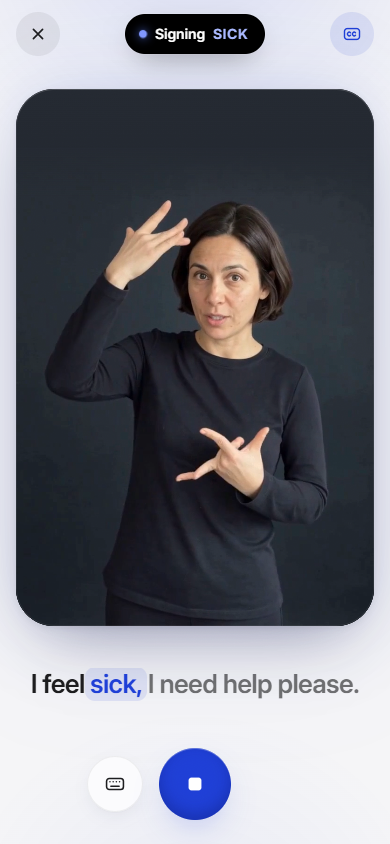
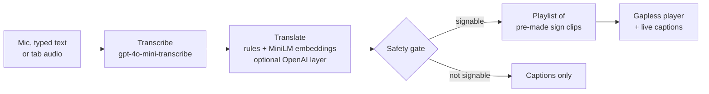
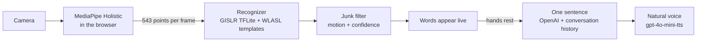
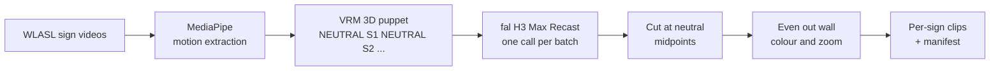
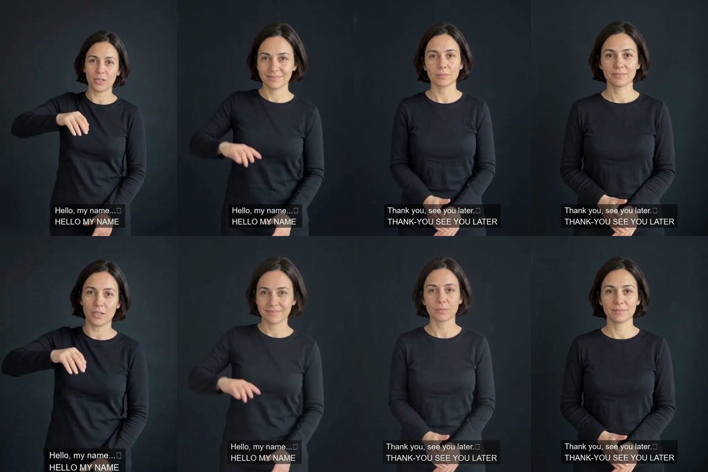

# Flux

**A live sign language interpreter that works both ways.** Speak, and a real-looking signer signs it in ASL. Sign to the camera, and Flux says it out loud.

<p align="center">
  
</p>

## Why it matters

There are about 70 million deaf people in the world, and together they use more than 300 sign languages ([World Federation of the Deaf](https://wfdeaf.org/)). For many of them, a sign language is the first language and written English is the second. Fast captions in a second language are tiring to follow, and most calls, lectures and videos offer nothing else.

Flux puts a signer next to any voice: a person in the room, a YouTube video, a Google Meet call. It also gives signers a voice back, from a phone or laptop camera, with no extra hardware.

## What it does

**Speech to sign**
- Listens to the mic, typed text, or any Chrome tab's audio (YouTube, Google Meet, Zoom web).
- Turns the words into an ASL sign plan in milliseconds, on your own machine.
- Plays a photoreal signer, one sign after another, with no gaps. The first sign starts about 0.2 s after a phrase arrives.
- Shows live captions with the current word highlighted. A word Flux can't sign stays in the captions. It never fakes a sign.

**Sign to voice**
- Tracks hands, body and face with MediaPipe in the browser. Only landmark points leave the device, never video.
- Recognizes 250 signs with a pretrained Kaggle model and 332 more with WLASL motion templates.
- Shows words as you sign them, and filters out transitions and resting hands.
- When your hands rest, writes one natural sentence (using the conversation from both sides) and speaks it in a natural voice.

**Where it runs**
- **Web app:** installable PWA, light frosted-glass design, phone first.
- **Chrome extension:** a floating, draggable glass card over any page, listening to the tab or the mic.
- **Phone app:** built with Expo.
- **Standalone build:** the web app and its clips in one bundle, no server needed (`npm run build:artifact` in `app/web`).

## How it works

### Speech to sign



The translator runs locally. Rules go first (about 0.2 ms), then MiniLM embeddings match leftover words by meaning (about 15 ms warm). If a sentence still can't be signed in full, an optional OpenAI layer paraphrases it into signs that exist. Every plan, local or not, passes the same safety gate, and any sign ID that isn't in the library is rejected.

### Sign to voice



The recognizer merges two models. The Kaggle GISLR first-place model knows 250 everyday signs. A template matcher adds 332 signs from WLASL motion we had already extracted, using banded DTW against every template at once. A segment with too little motion or too little confidence is dropped as a transition.

### The clip factory: the core idea

Generating video per sentence takes minutes. Flux generates every sign **once**, as a clip that starts and ends in the same neutral pose. Any sentence is then just clips played back to back.



1. **Extract.** MediaPipe pulls hand, body and face points from a real signer's video.
2. **Puppet.** A three.js VRM puppet re-performs the motion. Signs are batched as `NEUTRAL S1 NEUTRAL S2 ... NEUTRAL`.
3. **Repaint.** One fal H3 Max Recast call turns the whole puppet batch into a photoreal signer. It is frame exact (216 frames in, 216 out), so we know where every sign sits.
4. **Cut.** The video is cut at the middle of each neutral pause. Every clip starts and ends in the same pose, so clips join without a jump.
5. **Even out.** Each Recast job picks its own wall tone and zoom. `pipeline/even-clips.mjs` matches them across jobs, so clips from different batches join cleanly too.

<p align="center">
  
  <br><sub>Joins between clips from different Recast jobs. Top: before. Bottom: after <code>even-clips.mjs</code>.</sub>
</p>

Because the clips are made ahead of time, playback is instant and the video costs nothing per use. Optionally (`ONDEMAND=on`), a missing sign that already has extracted motion is generated in the background on first use and hot-loaded into the library.

## Numbers

Measured during the build on a laptop CPU with no GPU. Details are in [`experiments/`](experiments/).

| | |
|---|---|
| Signs the avatar can sign | **339** |
| Signs the recognizer knows | **250** (GISLR) **+ 332** (WLASL templates) |
| Time to first sign | **about 0.2 s** (a 3 to 4 sign sentence is built in 159 to 186 ms) |
| Text to sign plan | **0.2 ms** with rules, **about 15 ms** with embeddings |
| Recognizer accuracy on unseen WLASL signers | **86% top-1, 96% top-5** (100 clips, GISLR vocabulary) |
| Recognizer round trip | **49 ms** median through the API (30 ms in the model) |
| Template match against the whole bank | **20 to 40 ms** (363 templates) |
| Video cost per use | **$0** (clips are pre-made) |
| fal time to make one sign, once | **about 11 s** |
| New sign on demand, first use to playable | **127 s** (2 signs in one batch) |
| Wall-colour jump at a join between jobs | **18.9 down to 3.6** after evening out |
| Optional OpenAI planning layer | **1.35 s** median, about **$0.001** per sentence |

## Try it

You need Node 20+, Python 3.13 with [uv](https://docs.astral.sh/uv/), ffmpeg and Chrome. The sign clips live in `out/`, which is not in git because the source videos are licensed for non-commercial research only. Build them with the clip factory in `pipeline/` (see [`experiments/2026-11-15-mass-signs.md`](experiments/2026-11-15-mass-signs.md)).

```bash
git clone https://github.com/LedionBrati/sign-avatar-b-puppet.git
cd sign-avatar-b-puppet

(cd translate && npm i)                                          # local translator + embeddings model
(cd app/server && npm i)                                         # OpenAI SDK for the optional layers
(cd app/recognizer && uv sync && uv run python fetch_models.py)  # about 52 MB of pretrained models
(cd app/web && npm i && npm run build)                           # the API serves it at /app/

OPENAI_API_KEY_FILE=path/to/openai.key \
CLIPS_DIR=out/realtime/clips,out/realtime/clips-mass \
node app/start.mjs                                               # recognizer on :8788 + API on :8787
```

Open `http://localhost:8787/app/`. For live reload, run `npm run dev` in `app/web` (port 5173). With no server and no clips, `npm run dev:mock` serves a mock API.

**Chrome extension**

```bash
cd app/extension && npm i && npm run build
```

Open `chrome://extensions`, turn on Developer mode, click **Load unpacked** and pick `app/extension/.output/chrome-mv3`. Click the Flux icon on any tab, choose **Tab** or **Mic**, and press Start.

**Phone app:** `cd app/mobile && npm i && npx expo start`, then set the server URL to your computer's LAN address.

| Variable | What it does |
|---|---|
| `OPENAI_API_KEY_FILE` | Path to a file holding the OpenAI key. Turns on transcription, sentences, voice and the planning layer. |
| `FAL_KEY_FILE` | Path to a file holding the fal key. Only needed to make new clips. |
| `CLIPS_DIR` | Comma-separated clip folders, each with a `manifest.json`. The first folder wins on overlap. |
| `SIGNING_MODE` | `strict` (default) signs a phrase only when every word is signable. `relaxed` signs what it can and leaves the rest in the captions. |
| `ONDEMAND`, `MOTION_DIRS` | `ONDEMAND=on` makes missing signs in the background from extracted motion, capped by `FAL_DAILY_BUDGET_USD` (default 20). |
| `RECOGNIZER_URL`, `PORT` | Recognizer address (default `http://127.0.0.1:8788`) and API port (default 8787). |

Keys are read from files at startup and are never logged, echoed or returned.

## Repo map

| Folder | What's in it |
|---|---|
| [`app/server`](app/server) | Node API: sign plans, playlists, clips, transcription, voice, recognizer proxy, on-demand clips |
| [`app/recognizer`](app/recognizer) | Python recognizer: GISLR and fingerspelling TFLite models plus the WLASL template matcher |
| [`app/web`](app/web) | React + Vite web app (PWA) for both directions |
| [`app/extension`](app/extension) | Chrome extension (WXT, Manifest V3): the floating glass card |
| [`app/mobile`](app/mobile) | Expo phone app |
| [`app/core`](app/core) | Shared TypeScript: API contract, client, captions, landmark layout, design tokens |
| [`translate`](translate) | English to ASL sign plan: rules + local MiniLM embeddings, works offline |
| [`motion`](motion) | MediaPipe motion extraction, cleanup and QA ([`FORMAT.md`](motion/FORMAT.md) is the format) |
| [`puppet`](puppet) | three.js VRM puppet: join signs, play them live, render to mp4 |
| [`pipeline`](pipeline) | The clip factory: batches, Recast, cutting, evening out, mass runs |
| [`shared`](shared), [`catalog`](catalog) | Plan, catalog and motion contracts with their checkers |
| [`docs`](docs) | Findings, product plan and the [playback safety gate](docs/semantic-safety.md) |
| [`experiments`](experiments) | Every experiment we ran, with numbers, including the ones that failed |
| [`assets`](assets), [`references`](references), [`examples`](examples) | Avatar images, demo videos, reference clips with their licences, demo scripts |

## What's next

- **ASL grammar.** Today the translator produces signed English with ASL-like word order. Next is real ASL grammar, reviewed by Deaf signers.
- **More signs.** 1,831 WLASL signs are already ranked by how often the word is used. Rendering all of them takes about 6.4 h of fal time.
- **Sharper hands.** Rendering at 1080P and half speed turned smeared fast handshapes into readable ones in tests. It at least doubles the fal time per sign.
- **Fingerspelling in live signing.** The recognizer already reads fingerspelled letters (20 of 21 single letters right in a sanity check), but it is not yet part of the live flow.
- **Phones and groups.** Hand tracking that runs natively on phones, and more than one speaker per conversation.

## Team

Built at a hackathon by:

- **Nikos Fourlis** ([@fourlhs](https://github.com/fourlhs))
- **Alex Nomikos** ([@nomikosalex](https://github.com/nomikosalex))
- **Ledi Brati** ([@LedionBrati](https://github.com/LedionBrati))

## Licences and data

**Flux is a research demo for non-commercial use only.** The signer clips are made from datasets with non-commercial licences, so they can't be used in a paid product.

| Source | Used for | Licence |
|---|---|---|
| [WLASL](https://dxli94.github.io/WLASL/) | The sign videos behind every avatar clip and recognizer template | C-UDA, non-commercial research |
| [How2Sign](https://how2sign.github.io/) | Reference sentence clips | CC BY-NC 4.0 |
| [Kaggle GISLR, 1st place](https://huggingface.co/sign/kaggle-asl-signs-1st-place) | The 250-sign recognizer | MIT (trained on PopSign, CC BY 4.0) |
| [Kaggle ASL Fingerspelling, 1st place](https://github.com/ChristofHenkel/kaggle-asl-fingerspelling-1st-place-solution) | The fingerspelling recognizer | Apache-2.0 |

The sign plans have not been reviewed by ASL linguists, and the safety gate's statuses are engineering checks, not a linguistic review. Face landmarks count as biometric data: neither service logs or stores them, and audio is never stored.
