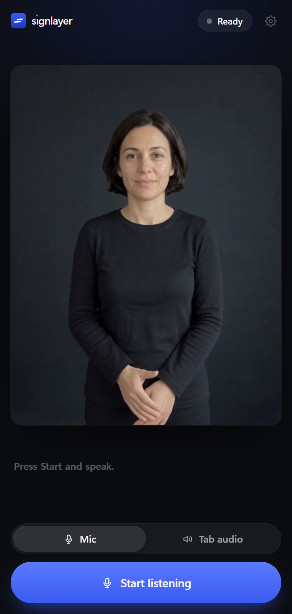
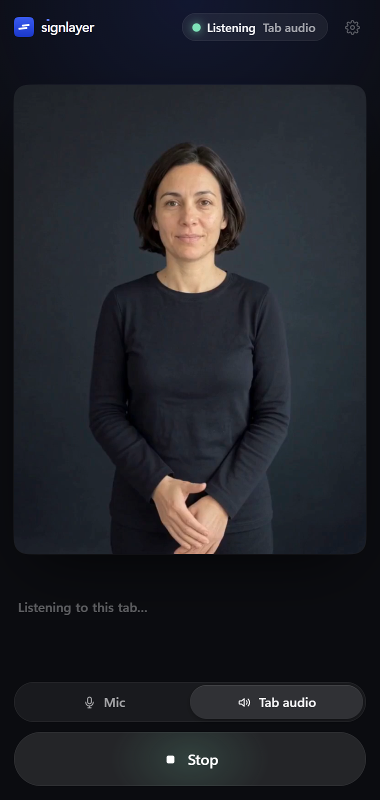
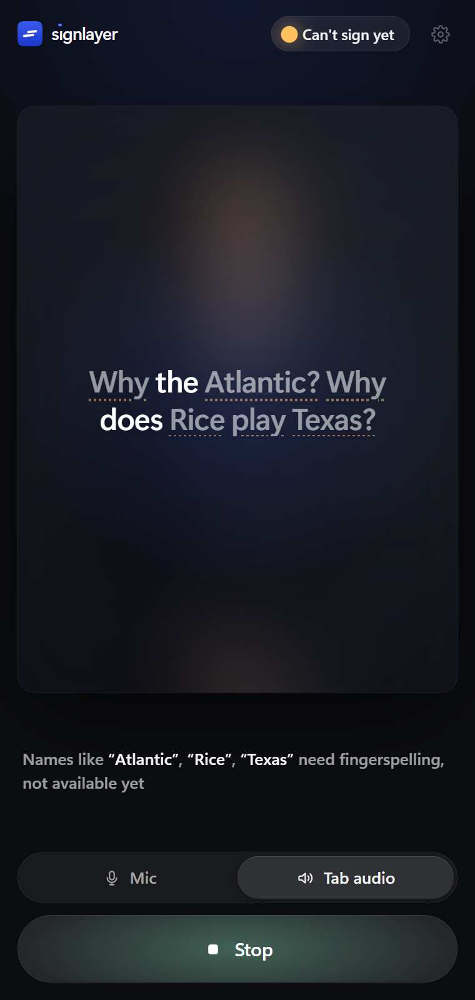
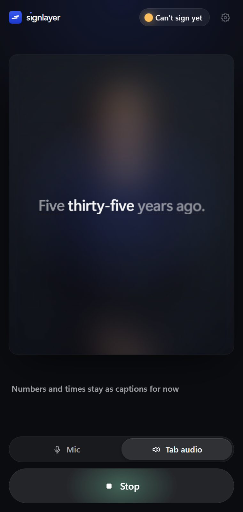

# SIGNLAYER Chrome extension

One side panel. Click the SIGNLAYER icon, pick **Mic** or **Tab audio**, press Start: the signer in the panel signs what it hears, with live captions under it. Built with WXT (Manifest V3, TypeScript, no framework) on `@signlayer/core` (`../core`: API client, caption word states).

| Ready | Listening (tab audio) | Can't sign yet | Can't sign yet (numbers) |
|---|---|---|---|
|  |  |  |  |

Screenshots come from `scripts/verify.mjs`: real Chrome, a local page playing JFK's Rice University speech (public domain, Wikimedia Commons), captured as Tab audio.

## Use it (3 steps)

1. **Load.** Start the API (`node app/server/index.mjs`, see `app/README.md`; Tab audio also needs `OPENAI_API_KEY_FILE=...` for speech-to-text). Then `cd app/extension && npm i && npm run build`, open `chrome://extensions`, turn on **Developer mode**, **Load unpacked** → `app/extension/.output/chrome-mv3`. (The pinned `key` keeps the ID at `alllgcabpfhomkddlfgmclmfobegigkg`.)
2. **Click the SIGNLAYER icon** in the toolbar, on the tab you want to hear. The side panel opens.
3. **Pick Mic or Tab audio, press Start.**
   - *Mic*: Chrome's speech recognition runs in the panel. The first time, a small tab opens and asks for the microphone (side panels can't show that prompt); it closes itself and listening starts.
   - *Tab audio*: the tab's sound is captured (you see Chrome's sharing indicator; the tab stays audible) and transcribed by the server.

The server URL (default `http://localhost:8787`) is behind the gear, top right.

## What you see

- **Status capsule**: Ready · Listening · Signing *GLOSS* · Can't sign yet · Offline · Mic off / Tab audio off.
- **Signer**: full 3:4 clip, head and both hands. Two stacked `<video>`s: the next clip preloads in the hidden one and crossfades in on its first painted frame, so there is never a black frame. Idle, it holds the neutral pose.
- **Captions**: words blur in, the word being signed is highlighted, words without a sign are muted.
- **Can't sign yet** (the server's safety gate, `docs/semantic-safety.md`): the player stops and clears, the exact caption comes forward on the blurred stage with the reason under it (*No sign yet for "college"*, *Numbers and times stay as captions for now*, ...). Never a stale clip. If it arrives while a phrase is still being signed, it waits for that phrase to finish. `needs_confirmation` shows the signs it would use and plays them only after **Show signs**.

## How tab audio works

All in the side panel page (`lib/tab-audio.ts`), no offscreen document:

1. The toolbar click fires `action.onClicked`; the background opens the side panel (`sidePanel.open`). That click is an action invocation, so Chrome grants `activeTab` on that tab. (We use `onClicked` + `sidePanel.open` rather than `setPanelBehavior({ openPanelOnActionClick })` so the grant is certain, and so clicking the icon on another tab re-grants there without closing the panel.)
2. **Start** → `tabCapture.getMediaStreamId({ targetTabId })` for the active tab → `getUserMedia({ audio: { mandatory: { chromeMediaSource: "tab", chromeMediaSourceId } } })` in the panel.
3. The stream goes to an `AudioContext` destination (capturing mutes the tab otherwise) and to an analyser + `MediaRecorder` (webm/opus). Chunks of 2-4 s, cut at a short silence when possible (a hard cut overlaps the next by 0.4 s); silent chunks are skipped.
4. `POST /api/transcribe` → text, in order, overlapping words dropped → `POST /api/sign` (requests run in parallel, results apply in order, overtaken ones are skipped, backlog over ~8 s is dropped, clips speed up to 1.15x/1.3x to catch up).

Errors are said plainly on the stage: Chrome pages can't be captured, "Click the SIGNLAYER icon while on the tab you want to hear" (no grant for that tab), tab already captured, capture refused, speech-to-text off on the server, and a soft hint when the tab is silent for 6 s.

## Files

- `entrypoints/background.ts`: opens the side panel on the toolbar click. Nothing else.
- `entrypoints/sidepanel/`: the product (UI, player, captions, sign requests).
- `entrypoints/mic/`: the one-time microphone permission tab.
- `lib/tab-audio.ts`, `lib/speech.ts` (Web Speech with restart + duplicate-final guard, as in `app/web/src/lib/speech.ts`), `lib/settings.ts` (`source`, `apiUrl` in `chrome.storage.local`), `lib/brand.ts`.
- Permissions: `storage`, `sidePanel`, `activeTab`, `tabCapture`. No host permissions, no content scripts.

## Verify

```bash
npm run build
SIGNLAYER_API=http://localhost:8787 AUDIO=path/to/speech.ogg SEEK=500 node scripts/verify.mjs
```

Installs the built extension over CDP (puppeteer-core), plays the audio on a local page, clicks the toolbar action (`Extension.triggerAction`: opens the real side panel and grants `activeTab`), then drives the panel page in a 380×800 tab (`sidepanel.html?tab=<id>` names the tab to capture; the real side panel can't be resized or screenshotted reliably), selects Tab audio, starts, and checks that chunks come back as text and get signed.

Last run (headless Chrome, JFK at 8:20): side panel opened; 4 chunks transcribed (0.7-3.2 s round trip), e.g. *"And they may well ask, why climb the highest mountain?"*, *"Why the Atlantic? Why does Rice play Texas?"*, *"We choose to go to the moon."*; the first was signed (AND THEY CAN), two came back caption-only (*"Five thirty-five years ago."*: numbers; the Atlantic/Rice/Texas line: names).

## Not covered yet

- The microphone path was not driven by automation (no microphone in the test Chrome, and the permission prompt can't be clicked).
- No signing screenshot yet: in the one run, a caption-only phrase arrived while the first phrase was signing and (then) cut it off; that is now fixed (blocked phrases wait their turn) but not re-run.
- Not yet tried on calls (Meet/Zoom web) or long sessions.
