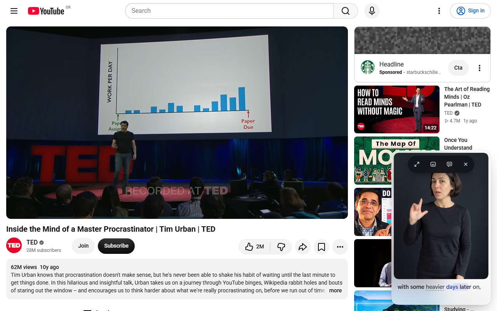
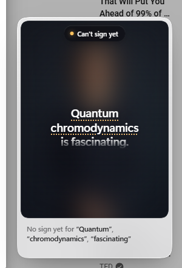
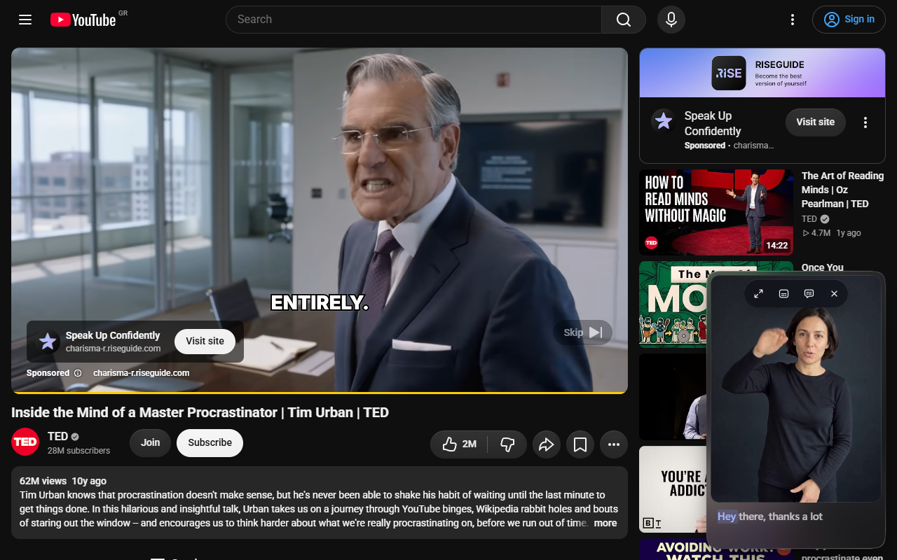
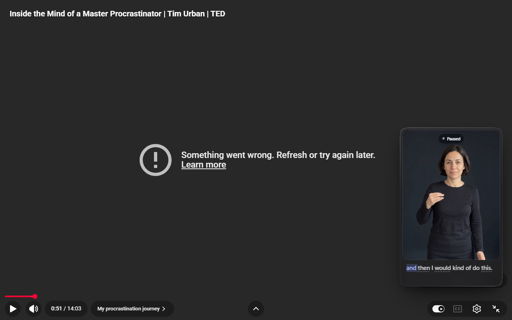
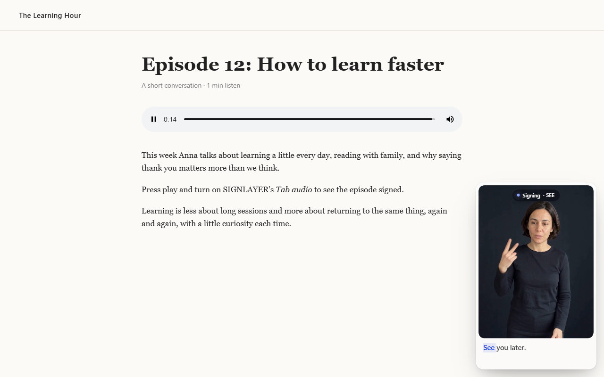
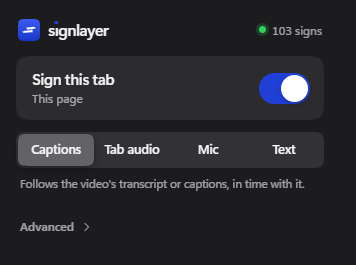
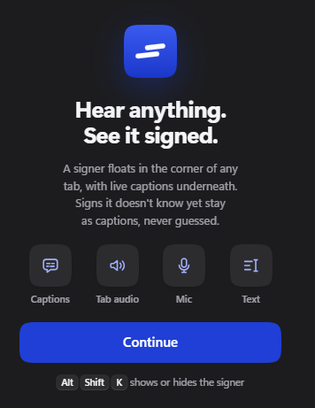

# SIGNLAYER Chrome extension

A signer that rides along with anything you play: a frosted signer card in the corner of any page, with captions under it that light up word by word as they are signed. It follows YouTube's transcript or captions, any video with caption tracks, the tab's own audio, your microphone, or text you select. Built with WXT (Manifest V3, TypeScript, no framework). It uses `@signlayer/core` (`../core`) for the API client, caption word states and design tokens.

Design notes: [docs/DESIGN.md](docs/DESIGN.md). Screenshots come from real Chrome on a real YouTube video (`scripts/verify-youtube.mjs`, `scripts/capture-2030.mjs`) and a local podcast page (`scripts/verify-tab-page.mjs`), with the API on port 8787.

| Signing (hover controls) | Can't sign yet | Dark page |
|---|---|---|
|  |  |  |

| Fullscreen | Tab audio | Popup | First run |
|---|---|---|---|
|  |  |  |  |

## Build and load

```bash
node app/server/index.mjs                 # the sign API on http://localhost:8787 (see app/README.md)
                                          # tab audio also needs OPENAI_API_KEY_FILE=... (speech-to-text)
cd app/extension
npm i
npm run build                             # -> .output/chrome-mv3
```

Open `chrome://extensions`, turn on **Developer mode**, click **Load unpacked** and pick `app/extension/.output/chrome-mv3`. The manifest pins a `key` (`manifest-key.json`), so the unpacked extension always gets the ID **`alllgcabpfhomkddlfgmclmfobegigkg`**.

The first time you open the menu (toolbar icon) it shows one screen on the four sources and the permission each one asks for.

## Use

- **Captions** (default). Open a YouTube video: the signer appears in the corner by itself and follows the video. It reads the video's transcript (the watch page's own *Show transcript* panel, opened off-screen for a moment and closed again), then sends each sentence in time with the video, fetching the next one ahead so signing starts on time. Pause, seek, ads and moving to another video are handled. Without a transcript (live streams) it reads the on-screen captions (turn on **CC**). On other sites it follows `<video>` caption tracks.
- **Tab audio.** Pick *Tab audio* in the menu. That click lets Chrome capture the tab (you see Chrome's sharing indicator). Audio is recorded in 2-5 s chunks, cut at short pauses, sent to the server's `POST /api/transcribe` (OpenAI `gpt-4o-mini-transcribe`), and the text is signed. The tab stays audible. Silent chunks are never sent. Text shows up about a second after each chunk ends (median round trip 0.5-0.8 s in our runs).
- **Microphone.** Pick *Mic* and click **Open the mic panel**. The side panel runs Chrome's speech recognition. The first time it opens a one-time **Enable microphone** tab, because side panels can't show the permission prompt.
- **Selected text.** Select text, then right-click › **Sign with SIGNLAYER**, or press **Alt+Shift+S**. Works with any source.
- **Alt+Shift+K** shows or hides the signer (and starts tab audio when that is the source).

**On the signer.** Move the pointer over it and the status capsule expands into the controls: size (cycles S/M/L), captions on/off, the source menu and close. Drag it anywhere: it snaps to the nearest corner and remembers it. In fullscreen YouTube it moves into the player and stays clear of the control bar. The status capsule says what is happening: *Listening · Transcript / Captions / Tab audio*, *Signing · GLOSS*, *Can't sign yet*, *Confirm signs?*, *Paused*, *Ad playing*, *Offline*.

**When a phrase can't be signed** (the server's safety gate, `docs/semantic-safety.md`), the signer never just goes quiet and never shows a stale clip: the player stops and clears, the caption sheet shows the exact caption (even with captions turned off), words without a sign are underlined, and the stage says why in plain words (*No sign yet for "college", "government"*, *Numbers and times stay as captions*, ...). For `needs_confirmation` (a paraphrase or an ambiguous word) it shows the signs it would use and waits: **Show signs** plays exactly that plan, **Skip** moves on. Nothing plays without that click.

## How it fits together

```
content script ──┐ (captions: transcript / CC / <track>)               ┌─► overlay.html (iframe in the page; extension origin)
side panel (mic) ┼─ runtime.sendMessage ─► background ──port──────────┤     POST /api/sign → playlist → 2 stacked <video>s
offscreen (tab) ─┘   (routes per tab,      │  tabCapture stream id     │     captionFrame() word states → caption sheet
context menu, shortcuts                    └─► offscreen.html ─► POST /api/transcribe
overlay ── postMessage(height, drag, close) ──► content script (positions the iframe, snaps, fullscreen)
```

- `entrypoints/overlay/`: the signer. Requests start as soon as a phrase arrives; results are applied in order and live sources skip results that were overtaken, so the signer stays near real time (backlog over ~8 s is dropped, clips speed up to 1.15x/1.3x to catch up).
- `lib/captions.ts`: the caption sources (YouTube transcript, CC MutationObserver, text tracks, SPA navigation, ads, seek). `lib/phrases.ts`: rolling-caption phrase assembly and transcript cues (unit tests in `test/`).
- `entrypoints/content.ts`: mounts the iframe in a closed shadow root, position, drag, fullscreen (`moveBefore`, so the iframe keeps playing).
- `entrypoints/background.ts`: message routing (queues messages for tabs whose content script is still loading and flushes them when it says hello), context menu, shortcuts, health, tab audio (`tabCapture.getMediaStreamId` + offscreen document).
- `entrypoints/offscreen/`: records the captured tab, keeps it audible, chunks, uploads, de-duplicates overlap.
- `entrypoints/popup/`, `sidepanel/`, `mic/`, `options/`.
- Settings in `chrome.storage.local`: `enabled`, `source`, `size`, `captions`, `corner`, `apiUrl`, `onboarded` (`lib/settings.ts`).

## What was wrong in v1 on real YouTube

Found by loading the extension into Chrome on a real video (`scripts/verify-youtube.mjs`):

1. The content script ran at `document_idle`, seconds after YouTube's page; the background's fallback injection failed on `https` pages (host permissions only covered `http`). Messages sent before it loaded, and the mount itself, were silently dropped.
2. The signer only appeared after the first successful caption, so with nothing coming through it looked like it did nothing.
3. Only the on-screen CC was read, by polling, so nothing happened with CC off. In automated Chrome, YouTube also returns empty caption files, so CC never shows; the transcript panel works everywhere.
4. Sign requests were chained one after the other (each can take 1-2 s with the agent layer), so the signer drifted further and further behind the video.
5. The S/M/L buttons never worked: a click listener on `<body data-size>` set the size straight back.

## Verify

```bash
npm run build
npm test                                   # phrase assembler + transcript cues (node --test)
node scripts/verify-youtube.mjs            # real YouTube: captions, controls, fullscreen, blocked/confirm states,
                                           # tab audio, popup + onboarding screenshots -> docs/v2-*.png
node scripts/verify.mjs                    # quick local check on test/page.html (no YouTube)
```

Both scripts install the built extension into Chrome over CDP with puppeteer-core (branded Chrome ignores `--load-extension` since v137). `SIGNLAYER_API` sets the API (default `http://localhost:8787`); tab audio needs a server with `transcribe: "ready"` in `/api/health`. The YouTube script opens the popup with `Extension.triggerAction` and clicks *Tab audio*, exactly the user gesture Chrome needs for tab capture; it un-mutes headless Chrome so there is audio to capture, and grants fullscreen (automated Chrome refuses it otherwise). `KEEP_AUDIO=dir` saves the recorded chunks; `node app/server/scripts/transcribe-bench.mjs dir` compares speech-to-text models on them.

## Not covered yet

- On-screen CC on real YouTube (the fallback for live streams) is covered only by the phrase-assembler unit tests: automated Chrome gets empty caption files from YouTube, so the CC path never fires there.
- The Alt+Shift+K / Alt+Shift+S shortcuts and the mic side panel were not driven by the automated runs (Chrome shortcuts can't be pressed from puppeteer; no microphone).
- Tab audio was run in headless Chrome on one video; not yet on calls (Meet/Zoom web) or long sessions.
