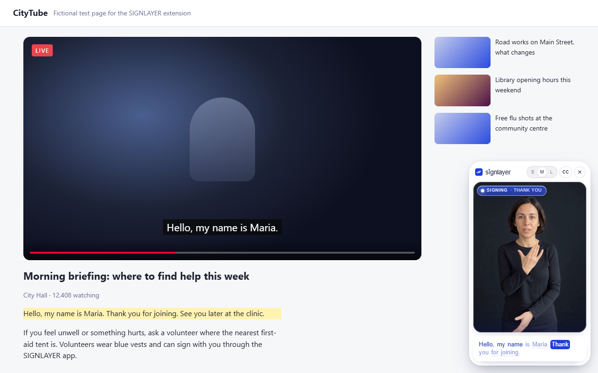
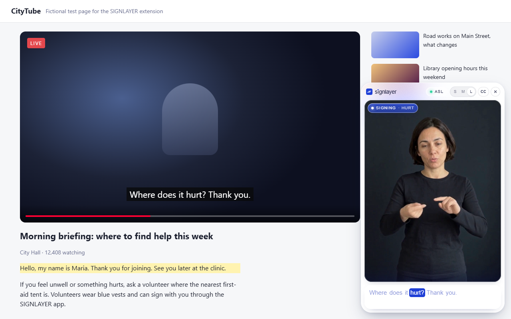

# SIGNLAYER Chrome extension

A signer that rides along with anything you play: a draggable, frosted signer card in the corner of any page, with captions under it that light up word by word as they are signed. Built with WXT (Manifest V3, TypeScript, no framework). It uses `@signlayer/core` (`../core`) for the API client, caption word states and design tokens.

| M | L |
|---|---|
|  |  |

## Build and load

```bash
node app/server/index.mjs                 # the sign API on http://localhost:8787 (see app/README.md)
cd app/extension
npm i
npm run build                             # -> .output/chrome-mv3
```

Then open `chrome://extensions`, turn on **Developer mode**, click **Load unpacked** and pick `app/extension/.output/chrome-mv3`. `npm run dev` runs WXT in watch mode and opens a browser with the extension loaded.

The manifest pins a `key` (`manifest-key.json`), so the unpacked extension always gets the ID **`alllgcabpfhomkddlfgmclmfobegigkg`**. Its origin is `chrome-extension://alllgcabpfhomkddlfgmclmfobegigkg`, which the API can allow for CORS. Extension pages also have `host_permissions` for `http://localhost/*` and any `http://` host on the LAN.

## Use

Click the toolbar icon to open the extension menu. It has the on/off switch, **Listen to** (Captions, Microphone, Selected text, Tab audio *coming soon*), signer size S/M/L, captions on/off, and the sign API URL with a live health check. The URL is also on the options page and defaults to `http://localhost:8787`. On a phone or another laptop, use `http://<LAN-IP>:8787`.

- **Selected text:** select text on any page, then right-click › **Sign with SIGNLAYER** or press **Alt+Shift+S**. This works with any source setting.
- **Captions:** play a YouTube video with **CC** on. The extension reads `.ytp-caption-segment`, waits for a pause in the captions (650 ms, and never holds a line longer than 1.6 s), drops words it already sent (rolling auto-captions) and repeated lines, then signs each new line. Lines that have not started yet are dropped once more than about 8 s are queued, and clips speed up (1.15x/1.3x) to catch up, so the signer stays close to live.
- **Microphone:** choose Microphone and click **Open the mic panel**. The side panel runs the Web Speech API and sends final phrases to the signer in the active tab, plus interim words, which show as "heard". Side panels can't show Chrome's permission prompt, so the first time it opens a one-time **Enable microphone** tab (`mic.html`).
- **On the signer:** drag the header to any corner (it snaps there, and the corner is remembered). The header also has S/M/L, CC (captions on/off) and close. The chip on the video shows *Listening · source*, *Translating*, *Signing · GLOSS*, *Can't sign yet* or *Offline*. Words without a clip yet, plus names that would need fingerspelling, are underlined with dots and never invented.

## How it fits together

```
content script ─┐                                   ┌─► overlay.html (iframe in the page; extension origin)
side panel ─────┼─ runtime.sendMessage ─► background ┤     POST /api/sign → playlist → 2 stacked <video>s
context menu ───┘   (routes per tab)     (port)     │     (hidden one preloads the next clip, swap on "ended")
shortcut ───────────────────────────────────────────┘     captionFrame() word states → caption sheet
overlay ── postMessage(height, drag) ──► content script (positions the iframe, snaps to corners)
```

- `entrypoints/overlay/` is the signer. It is a `web_accessible_resources` page inside an iframe, so a page's CSP can't block its `<video>` or API calls. The content script hosts the iframe in a closed shadow root and puts the backdrop blur on the iframe element, so the glass really blurs the page behind it.
- `entrypoints/content.ts`: mounts the iframe, handles position, size and drag (with a full-page shield as a fallback when the page gets the pointer), and runs the caption watcher.
- `entrypoints/background.ts`: context menu, Alt+Shift+S, routing to each tab's overlay (it injects the content script into tabs opened before install), and `/api/health`.
- `entrypoints/popup/`, `sidepanel/`, `mic/`, `options/`: the extension menu, the mic listener, the permission tab, and the API URL.
- Settings live in `chrome.storage.local`: `enabled`, `source`, `size`, `captions`, `corner`, `apiUrl` (`lib/settings.ts`).

## Verify

```bash
npm run build && npm run verify           # needs the API running (SIGNLAYER_API=http://localhost:8787)
```

`scripts/verify.mjs` installs the built extension into Chrome over CDP with puppeteer-core. Branded Chrome ignores `--load-extension` since v137, so it can't be loaded from the command line. The script opens `test/page.html`, which has some text and a fake YouTube caption element. It then signs text the same way the context menu does, swaps the caption line, drags the signer to a corner, and checks the menu's API status. It saves `docs/overlay-m.png` and `docs/overlay-l.png`. `node scripts/make-icons.mjs` re-renders the icons from the mark in `core/src/tokens.ts`.

## Not in v1

- **Tab audio** speech-to-text needs a cloud STT, so it shows as *coming soon* in the menu.
- **Fullscreen video:** the signer lives on the page, so it is hidden while a video is fullscreen.
- **Not yet tested on real YouTube or with a real microphone.** Both were built against the documented DOM and APIs, but the automated check only covers the fake caption markup.
