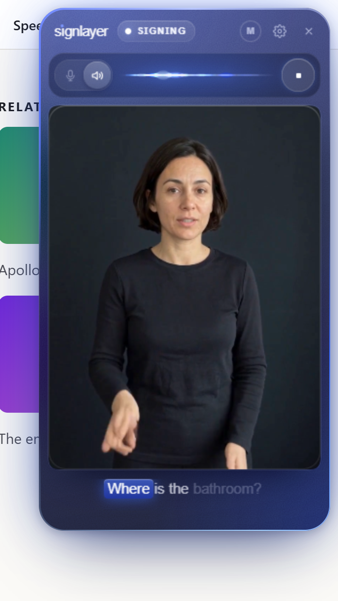
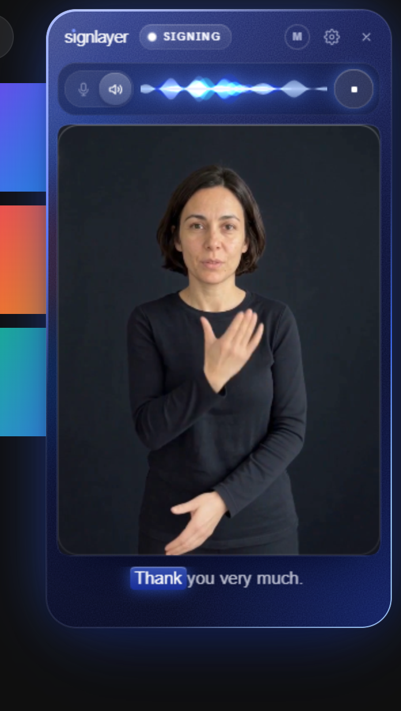
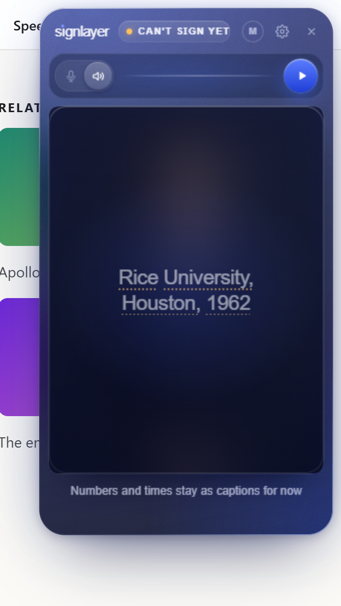

# SIGNLAYER Chrome extension

A small floating glass card on top of any page. Click the SIGNLAYER icon: the card appears over the tab, with a live voice wave on top, the signer under it and captions under the signer. Pick **Tab** (this tab's audio) or **Mic**, press Start. Built with WXT (Manifest V3, TypeScript, no framework) on `@signlayer/core` (`../core`).

| Light page, signing | Dark page, listening | Can't sign yet |
|---|---|---|
|  |  |  |

## Use it

1. Start the API (`node app/server/index.mjs`, see `app/README.md`; speech-to-text needs `OPENAI_API_KEY_FILE=...`). `cd app/extension && npm i && npm run build`, `chrome://extensions` → Developer mode → **Load unpacked** → `.output/chrome-mv3` (pinned ID `alllgcabpfhomkddlfgmclmfobegigkg`).
2. **Click the SIGNLAYER icon** on the tab you want to hear. The card appears (top right, or where you left it). Click again to close it (or ×).
3. **Tab** or **Mic**, then ▶. Drag the card by its header; **S/M/L** resizes it; the gear sets the server URL (default `http://localhost:8787`, an https tunnel works too). Position and size are remembered.

The first Mic use opens a small tab that asks for the microphone once (an iframe or offscreen document can't show Chrome's prompt); it closes itself and listening starts.
Chrome's own pages (chrome://, the Web Store) can't host the card: the icon shows a "!" badge with the reason.

If the card says **Can't reach the server**, the URL in ⚙ doesn't answer (the default `http://localhost:8787` only works on the laptop running the API). Press **Set server** and enter the right one (another machine's `http://<ip>:8787`, or an https tunnel URL). It retries by itself every 10 s.

## Where it works

- **YouTube** (and other video sites): Tab mode. The video stays audible while captured (the offscreen document plays the captured audio back). The card stays through YouTube's in-app navigation (no reload) and ads are signed like the rest. In **fullscreen** the card is lifted into the top layer, so it stays on top of the player; after exiting it is where it was.
- **Google Meet, Zoom web client** (`app.zoom.us/wc/...`), Teams web: Tab mode signs the other people's voices; the call keeps its own microphone and audio. On these sites the card starts top-left and never covers the bottom control bar. Listening goes on when you switch to another tab (signs catch up with the newest phrase when you come back). Headphones avoid any chance of the others hearing an echo.
- **Mic** mode signs whatever your microphone hears (your own voice, a speaker in the room), at the same time as a call uses the mic.
- **Zoom / Teams desktop apps**: a browser extension can't hear another app. Join the call from the browser instead ("Join from your browser" on the Zoom invite page), or use **Mic** with the call on your speakers. If a tab stays silent, the card says so.

## The card

- **Header** (drag handle): wordmark, status chip (Ready · Listening · Signing · Can't sign yet · Offline · Off), S/M/L, gear, ×.
- **Voice band**: Mic | Tab toggle, the live wave (driven by the real audio level; a calm line when silent, cobalt lobes while speech is detected), Start/Stop.
- **Signer**: 3:4 real-signer clips on a soft cobalt halo; two stacked `<video>`s crossfade, never a black frame.
- **Captions**: word by word, the word being signed highlighted, words without a sign muted.
- **Safety gate**: `caption_only` / `needs_confirmation` stop the player; the exact caption and the reason come forward on the stage (`needs_confirmation` plays only after **Show signs**).
- Look: dark cobalt "liquid glass" (backdrop blur 30px, saturate 180%, grain, light-catching rim, slow sheen; a cobalt ring of light and glow while listening/signing). Reads on light and dark pages.

## How it works

```
toolbar click ─► background: scripting.executeScript(float.js) into the tab   (activeTab granted by the click)
float.js      ─► <signlayer-float> closed shadow root: glass frame + iframe(overlay.html) + drag grip
overlay.html  ─► the UI (extension page: the site's CSS/CSP never apply). Start ─► background
background    ─► tabCapture.getMediaStreamId({ targetTabId }) ─► offscreen document
offscreen     ─► getUserMedia (tab stream id, or the mic) ─► AudioContext (keeps the tab audible) + analyser + MediaRecorder
                 2-4 s chunks cut at silences ─► POST /api/transcribe ─► text + level ─► that tab's card
card          ─► POST /api/sign ─► playlist ─► signer + captions
```

- Audio never depends on the page (its permissions policy, CSP or focus): it is all in the offscreen document. One capture at a time; clicking the icon on another tab while Tab audio is running opens the card there and moves listening to it (the old card says so).
- The card keeps a port to the background while listening: closing the card, navigating or closing the tab stops the capture.
- Drag: a transparent grip over the header's non-button part (in the page frame), so dragging runs in page coordinates; the card is clamped inside the viewport (also on resize). Only the card takes clicks; the rest of the page is untouched.

## Permissions

| Permission | Why |
|---|---|
| `activeTab` | The toolbar click grants access to that tab: inject the card, capture its audio. No host permissions. |
| `scripting` | Inject the card (`float.js`) on the click. No content scripts run on any page otherwise. |
| `tabCapture` | Get the tab's audio stream id. |
| `offscreen` | The audio capture + speech-to-text document. |
| `storage` | Source, server URL, size, card position. |
| host `http://localhost/*`, `http://127.0.0.1/*` | The default local server. Not strictly needed: extension pages count as loopback for Chrome's Local Network Access rules (no prompt even from an https page), and the server answers CORS `*` plus the Private Network Access preflight, which is also all an https tunnel URL needs. |

`overlay.html` is a web-accessible resource so it can be framed on any page. Chrome lets extension frames past a page's CSP `frame-src` (Zoom's, for one, doesn't list `chrome-extension:`), and the in-page script builds its frame with DOM calls only, so Trusted Types pages (YouTube, Meet) don't block it.

## Files

- `entrypoints/background.ts`: toolbar toggle, start/stop broker, offscreen document, Chrome-page badge.
- `entrypoints/float.ts`: the in-page frame (glass, rim, glow, drag, position).
- `entrypoints/overlay/`: the card UI (player, captions, sign requests, safety gate).
- `entrypoints/offscreen/`: capture + transcription. `entrypoints/mic/`: one-time microphone permission tab.
- `lib/capture.ts` (chunker, error wording), `lib/wave.ts` (voice wave), `lib/messages.ts`, `lib/settings.ts`, `lib/brand.ts`.

## Verify

```bash
npm run build
AUDIO=path/to/speech.wav node scripts/verify.mjs     # SIGNLAYER_API=http://localhost:8787 by default
```

Real Chrome (headless, `--disable-audio-output`: nothing is audible, the tab still produces audio for capture; `--mute-audio` can't be used, a muted tab captures as silence). A local light page and a dark page play the recording (started by a real click); `Extension.triggerAction` clicks the icon; the script drags the card, checks the saved position and viewport clamp, starts Tab audio, waits for text → `fully_supported` → signing with captions, stops, shows a caption-only phrase, cycles S/M/L, closes the card with a second icon click and with ×, and checks the "!" badge on chrome://version. Screenshots go to `screenshots/`.

## Not covered yet

- Mic was not driven by automation (no microphone in the test Chrome; the permission prompt can't be clicked). It uses the same offscreen chunker as Tab audio.
- Meet / Zoom web, YouTube fullscreen and long sessions were reviewed in code, not yet driven in a real browser.
