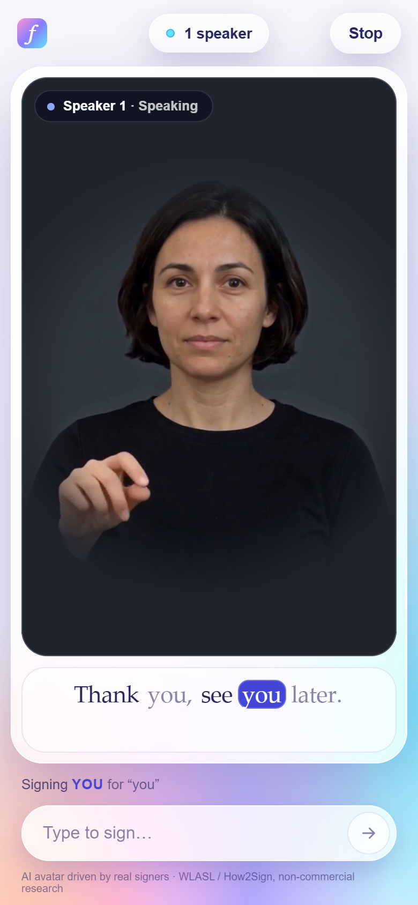
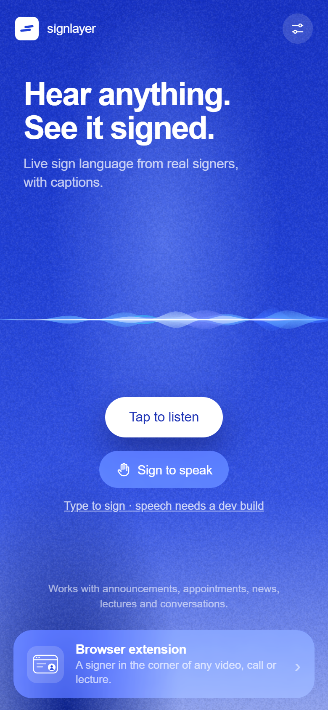
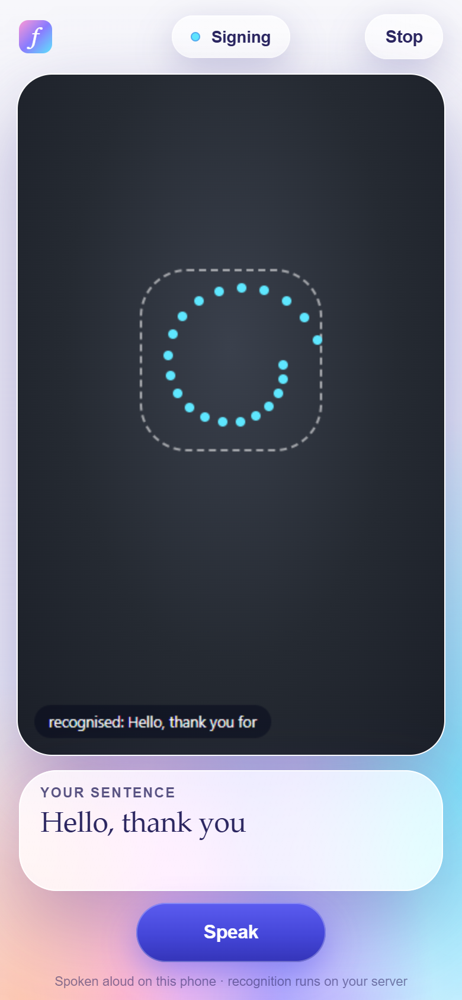
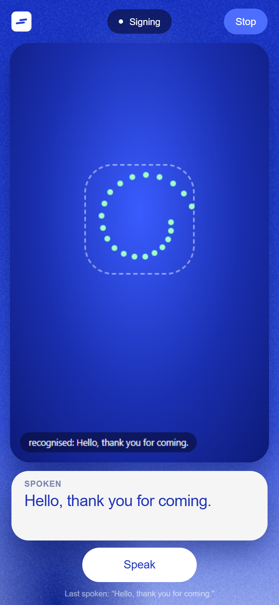
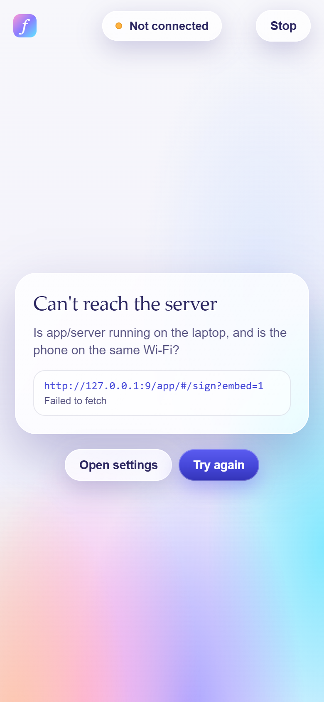

# Flux mobile

The phone app: **hear anything, see it signed.** Expo (React Native, TypeScript), SDK 58. It has the same two screens as the team prototype: **Home** ("Tap to listen") and **Live** (status island, signer card, word-by-word captions, done summary with Replay and Listen again). There is also a **Server** settings sheet, and the other direction: **Sign to speak** (camera → sentence → spoken aloud).

| Home | Live, mid-signing | Done |
|---|---|---|
|  |  |  |

*(The screenshots come from the web export in typed mode, driven headless against the real `app/server`.)*

## How it works

```
mic ─► expo-speech-recognition (on device, continuous, interim results)
         └─ each final phrase ─► POST /api/sign {text} ─► playlist of clips (768×1024, 24 fps)
typed text ───────────────────┘                         └─► appended to one running session
two expo-video players: one plays clip i, the other has clip i+1 loaded and paused ─► swap on end (gapless)
current clip index ─► captionFrame() from @flux/core ─► heard / signed / now (tinted) word states
```

- **Contract:** `@flux/core` is imported straight from `../core` (TypeScript source, nothing copied). `metro.config.js` adds `../core` to `watchFolders` and aliases the package, and `tsconfig.json` maps the path.
- **Never faking a sign:** words the server lists in `unsupported`/`fingerspell` that no clip covers stay muted with a dotted underline, never solid, and the summary counts them ("1 word without a sign yet").
- **Phrases stay in order:** requests run in parallel, but results are appended in the order the phrases were heard.
- **Device touches:** haptics on start and stop, the screen stays awake while live, safe areas, and a light status bar on the blue background.
- **Design:** tokens come from `app/core/src/tokens.ts`. Gradients use `expo-linear-gradient`, frosted pills and cards use `expo-blur`, and the mark and listening wave use `react-native-svg` (a port of the prototype's canvas wave). Grain is a generated tile, `assets/noise.png` (`node scripts/make-noise.mjs`). React Native has no CSS `mask-image`, so the signer's radial mask is an SVG vignette that fades into the card colour.

## Sign to speak

| Home | Signing (stub page) | Spoken | Server without /app/ |
|---|---|---|---|
|  |  |  |  |

The phone doesn't run MediaPipe natively (that would need frame-processor native modules and a long build). It shows the web app's camera screen in a WebView instead:

```
Sign screen ─► OS camera permission (expo-camera) ─► GET <server>/app/ (preflight) ─► WebView <server>/app/#/sign?embed=1
   page: getUserMedia + MediaPipe landmarks ─► POST /api/recognize ─► composeSentence()
   page posts {type:"sentence", text} ─► native caption sheet under the camera card
   page posts {type:"speak", text}    ─► expo-speech Speech.speak(text, {language:"en-US"}) + haptics
   native "Speak" button              ─► speaks the latest sentence
```

- **Bridge:** `src/lib/bridge.ts`. A script injected before the page loads forwards `window.postMessage` (the page can post to `window.parent`, which is itself at the top level) to `ReactNativeWebView.postMessage`, so the page can use either. It also reports `{type:"env"}` (secure context, getUserMedia present). Repeated identical `speak` messages within 0.7 s count once.
- **Needs:** `app/server` serving the built web app at `/app/` (`ROUTES.webApp`). If the server can't be reached or `/app/` returns 404, you get a screen with the URL, **Open settings** and **Try again**. If camera permission is denied, the screen offers **Open phone settings**.
- **Camera inside the WebView: needs https or localhost.** Android WebView and WKWebView only expose `navigator.mediaDevices` in a secure context, and a plain `http://192.168.x.x:8787` page isn't one. The screen shows a warning when the page reports this. Options:
  - Android over USB: `adb reverse tcp:8787 tcp:8787`, then set the server URL to `http://localhost:8787`.
  - Any phone: expose the server over HTTPS (any tunnel or host, or `app/server` behind a cert the phone trusts) and set that URL as the server URL in the app settings.
- **Permissions:** `app.json` has iOS `NSCameraUsageDescription` (and the `expo-camera` plugin with the same string) and Android `CAMERA`. Before the WebView loads, the screen asks for the OS permission with `Camera.requestCameraPermissionsAsync()`.
  - iOS (WKWebView, iOS 15+): `mediaCapturePermissionGrantType="grant"` stops the page from showing a second web prompt. `allowsInlineMediaPlayback` and `mediaPlaybackRequiresUserAction={false}` keep the preview inline and autoplaying.
  - Android (`react-native-webview` 14.0.1): `RNCWebChromeClient.onPermissionRequest` grants `RESOURCE_VIDEO_CAPTURE` itself when `CAMERA` is already granted, and asks the OS otherwise. There's no JS `onPermissionRequest` prop to wire up. `allowsProtectedMedia` is only for DRM and isn't needed.
- **Expo Go vs dev build:** `react-native-webview`, `expo-camera` and `expo-speech` are all in Expo Go, so Sign to speak works in Expo Go (the permission prompt names Expo Go instead of Flux). A dev build (`npx expo run:android|ios`) uses the app's own strings.
- **Web export:** `SignFrame.web.tsx` renders an `<iframe allow="camera">` with the same URL and accepts `postMessage` only from that iframe. `?sign=<url>` overrides the embed URL (used by the smoke test with `scripts/sign-stub.html`, a stand-in that posts the same messages).

## Run it

Start the server on the laptop first (from the repo root):

```bash
node app/server/index.mjs          # binds 0.0.0.0:8787
```

### Expo Go: typed mode only

```bash
cd app/mobile && npm i && npx expo start
```

Scan the QR code with Expo Go. The speech module isn't in Expo Go, so the app finds that out and uses **Type to sign**. Everything else works the same: playlist, captions, Replay.

### Development build: speech recognition

On-device speech needs the native `expo-speech-recognition` module, so you have to build the app once:

```bash
npx expo run:android               # Android Studio / SDK + a device or emulator (npm run android)
npx expo run:ios                   # macOS + Xcode (npm run ios)
# later: eas build --profile development (not set up here, no cloud builds were used)
```

The config plugin adds the permission strings: iOS `NSSpeechRecognitionUsageDescription` and `NSMicrophoneUsageDescription`, Android `RECORD_AUDIO`, plus the Google speech service package query. Cleartext HTTP to the LAN server is allowed: Android through `expo-build-properties`, iOS through `NSAllowsLocalNetworking`.

### Server URL

Tap the sliders icon on Home to open the settings sheet. Enter `http://<laptop LAN IP>:8787`, tap **Test connection** (it calls `GET /api/health`), then **Save**. The URL is saved with AsyncStorage. The app suggests an address on its own: in development it uses the Metro host's IP, which is the laptop. The phone and the laptop must be on the same Wi-Fi.

### Web preview

```bash
npx expo start --web               # or: npx expo export --platform web  (static build in dist/)
```

On web, `?server=http://localhost:8787` sets the server URL. The web build always uses typed mode and plays clips with a small plain `<video>` player (`PlaylistPlayer.web.tsx`), because expo-video's web view resets `src` on every render. Phones use `PlaylistPlayer.tsx` (expo-video).

## Checks

```bash
npx tsc --noEmit
npx expo-doctor                    # 20/20
npx expo export --platform web
node scripts/web-smoke.mjs         # headless Chrome, typed flow, rewrites docs/*.png (see header for setup)
node scripts/sign-smoke.mjs        # headless Chrome, Sign to speak against scripts/sign-stub.html + the real /app/; docs/sign-*.png
```

## Not yet verified on a real phone

- Speech recognition: permissions, continuous mode, final vs interim results on iOS and Android.
- expo-video two-player swap timing on device. On web the swap is gapless.
- Sign to speak in a real WebView: camera inside the page (https/localhost), the iOS grant flow, MediaPipe speed in WKWebView and Android WebView, and expo-speech voices.
- Blur and SVG performance on low-end Android, and how the keyboard and safe areas behave on notched phones.

**Data:** the clips are WLASL signers repainted by H3 Max. This is non-commercial research data, for private demos only.
