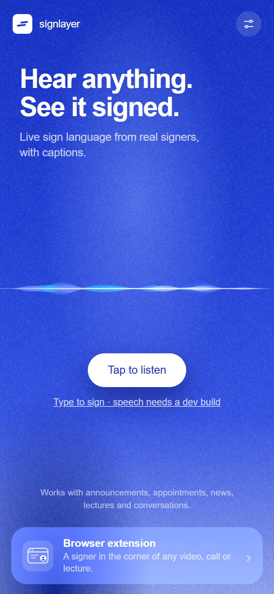
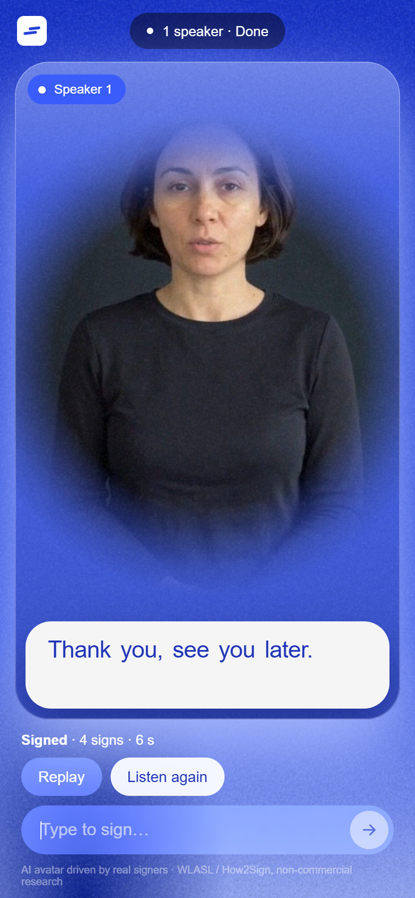

# SIGNLAYER mobile

The phone app: **hear anything, see it signed.** Expo (React Native, TypeScript), SDK 58. It has the same two screens as the team prototype: **Home** ("Tap to listen") and **Live** (status island, signer card, word-by-word captions, done summary with Replay and Listen again). There is also a **Server** settings sheet.

| Home | Live, mid-signing | Done |
|---|---|---|
|  |  |  |

*(The screenshots come from the web export in typed mode, driven headless against the real `app/server`.)*

## How it works

```
mic ─► expo-speech-recognition (on device, continuous, interim results)
         └─ each final phrase ─► POST /api/sign {text} ─► playlist of clips (768×1024, 24 fps)
typed text ───────────────────┘                         └─► appended to one running session
two expo-video players: one plays clip i, the other has clip i+1 loaded and paused ─► swap on end (gapless)
current clip index ─► captionFrame() from @signlayer/core ─► heard / signed / now (tinted) word states
```

- **Contract:** `@signlayer/core` is imported straight from `../core` (TypeScript source, nothing copied). `metro.config.js` adds `../core` to `watchFolders` and aliases the package, and `tsconfig.json` maps the path.
- **Never faking a sign:** words the server lists in `unsupported`/`fingerspell` that no clip covers stay muted with a dotted underline, never solid, and the summary counts them ("1 word without a sign yet").
- **Phrases stay in order:** requests run in parallel, but results are appended in the order the phrases were heard.
- **Device touches:** haptics on start and stop, the screen stays awake while live, safe areas, and a light status bar on the blue background.
- **Design:** tokens come from `app/core/src/tokens.ts`. Gradients use `expo-linear-gradient`, frosted pills and cards use `expo-blur`, and the mark and listening wave use `react-native-svg` (a port of the prototype's canvas wave). Grain is a generated tile, `assets/noise.png` (`node scripts/make-noise.mjs`). React Native has no CSS `mask-image`, so the signer's radial mask is an SVG vignette that fades into the card colour.

## Run it

Start the server on the laptop first (from the repo root):

```bash
node app/server/index.mjs          # binds 0.0.0.0:8787
```

### Expo Go: typed mode only

```bash
cd app/mobile && npm i && npx expo start
```

Scan the QR code with Expo Go. The speech module isn't in Expo Go, so the app finds that out and uses **Type to sign**. Everything else works the same: playlist, captions, Replay.

### Development build: speech recognition

On-device speech needs the native `expo-speech-recognition` module, so you have to build the app once:

```bash
npx expo run:android               # Android Studio / SDK + a device or emulator (npm run android)
npx expo run:ios                   # macOS + Xcode (npm run ios)
# later: eas build --profile development (not set up here, no cloud builds were used)
```

The config plugin adds the permission strings: iOS `NSSpeechRecognitionUsageDescription` and `NSMicrophoneUsageDescription`, Android `RECORD_AUDIO`, plus the Google speech service package query. Cleartext HTTP to the LAN server is allowed: Android through `expo-build-properties`, iOS through `NSAllowsLocalNetworking`.

### Server URL

Tap the sliders icon on Home to open the settings sheet. Enter `http://<laptop LAN IP>:8787`, tap **Test connection** (it calls `GET /api/health`), then **Save**. The URL is saved with AsyncStorage. The app suggests an address on its own: in development it uses the Metro host's IP, which is the laptop. The phone and the laptop must be on the same Wi-Fi.

### Web preview

```bash
npx expo start --web               # or: npx expo export --platform web  (static build in dist/)
```

On web, `?server=http://localhost:8787` sets the server URL. The web build always uses typed mode and plays clips with a small plain `<video>` player (`PlaylistPlayer.web.tsx`), because expo-video's web view resets `src` on every render. Phones use `PlaylistPlayer.tsx` (expo-video).

## Checks

```bash
npx tsc --noEmit
npx expo-doctor                    # 20/20
npx expo export --platform web
node scripts/web-smoke.mjs         # headless Chrome, typed flow, rewrites docs/*.png (see header for setup)
```

## Not yet verified on a real phone

- Speech recognition: permissions, continuous mode, final vs interim results on iOS and Android.
- expo-video two-player swap timing on device. On web the swap is gapless.
- Blur and SVG performance on low-end Android, and how the keyboard and safe areas behave on notched phones.

**Data:** the clips are WLASL signers repainted by H3 Max. This is non-commercial research data, for private demos only.
