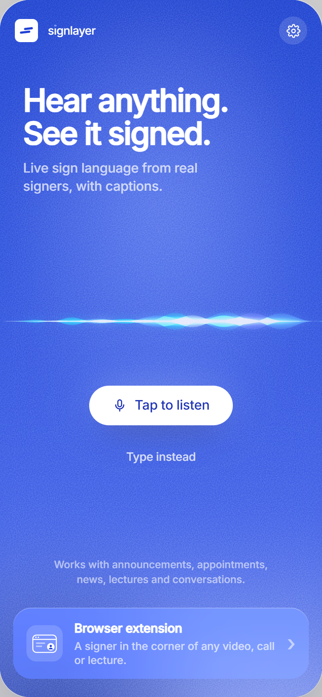
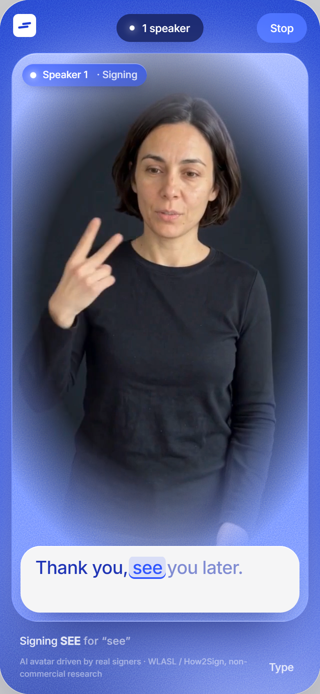
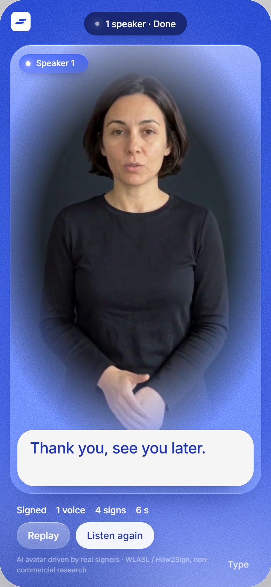

# SIGNLAYER web app

**Hear anything. See it signed.** The installable web app (PWA): tap to listen, and an AI signer card signs what it hears with live captions. Vite + React + TypeScript, built on the shared contract in `../core` (`@signlayer/core`).

| Home | Live (signing) | Done |
|---|---|---|
|  |  |  |

## Quickstart

```bash
node app/server/index.mjs            # the sign API on http://localhost:8787 (from the repo root)
cd app/web && npm i && npm run dev   # http://localhost:5173
```

No server yet? `npm run dev:mock` serves a toy `/api/sign` plus the real clips from the Vite dev server itself (clips folder: `CLIPS_DIR`, else `out/realtime/clips`, else `../sign-avatar-b-puppet/out/realtime/clips` next to the repo).

| Command | What |
|---|---|
| `npm run dev` | dev server, API at `VITE_API_URL` (default `http://localhost:8787`) |
| `npm run dev:mock` | dev server + mock API on the same origin |
| `npm run build` | typecheck + production build to `dist/` (with the service worker) |
| `npm run typecheck` | `tsc` for the app and the Vite config |
| `npm run shots` | headless Chrome types "Thank you, see you later." and saves `docs/home.png`, `live.png`, `done.png` (needs a running dev server; `APP_URL`, `TEXT`, `MID`, `CHROME`) |

**API base:** the gear on the home screen sets the server URL (saved in localStorage). On a phone, use your computer's LAN address (`http://192.168.x.x:8787`) and start Vite with `--host` (on by default here). The order is the settings field, then `VITE_API_URL`, then `http://localhost:8787`.

## How it works

- **Listening** uses the Web Speech API (`webkitSpeechRecognition`, continuous, interim results, en-US). Interim words show under the big wave (and later in the captions, faded); each final phrase goes to `POST /api/sign` and its playlist is appended to the running queue. Phrases are appended in spoken order even if responses come back out of order.
- **Type to sign** is always there ("Type instead" on home, "Type" on the live screen). It is the only input on browsers without speech recognition (Firefox, Safari as a home-screen PWA). If the mic is blocked, a banner explains how to allow it and offers Retry.
- **Gapless player** (`src/lib/player.ts`): two stacked `<video>`s. The next clip preloads in the hidden one; on `ended` it starts and moves to the front on its first presented frame. Every clip starts and ends in the same neutral pose, so they join seamlessly. Clips are fetched once into `blob:` URLs, so a swap never waits on the network. In testing, the longest frozen stretch was about 20 ms.
- **Captions** come from `captionFrame()` in core: heard, then signed, with a gliding highlight on the word being signed and the "Signing X for “word”" line. Words without a clip stay muted and dotted ("Can't sign yet"). Names the translator would fingerspell show "Fingerspelling not available yet". Nothing is ever faked.
- **Lanes:** one speaker card by default (`<Lane>` supports N speakers: lit, quiet and unseen states, one colour per speaker from `tokens.speakers`).
- **PWA:** `public/manifest.webmanifest` (cobalt theme, mark icons), and `public/sw.js` caches the app shell only, never `/api` or `/clips`. It also has iOS meta tags and safe-area insets. The service worker registers only in production builds (`npm run build && npm run preview`).

## Not done / limits

- The mic path needs a real browser with a microphone (Chrome/Edge; it sends audio to the browser's speech service). It can't be tested headless; the denied-permission banner was checked.
- No speaker diarization: everything goes into Speaker 1.
- The browser extension card on home is informational (see `app/extension`).
