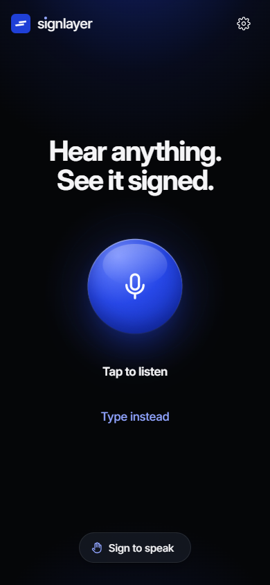
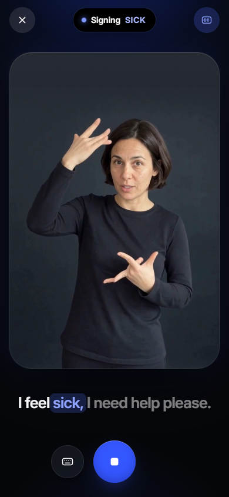
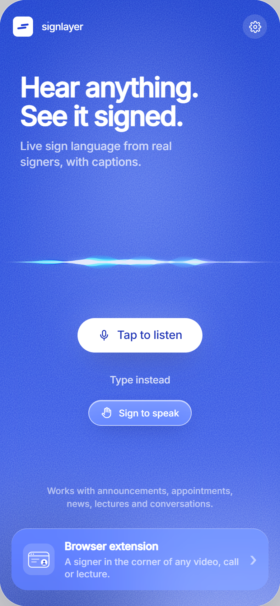
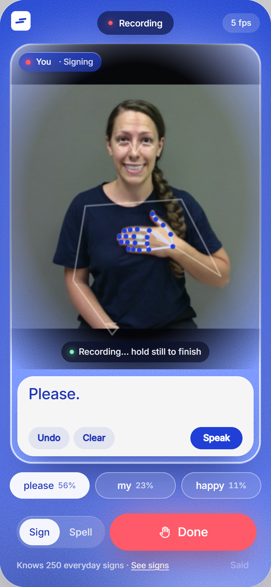
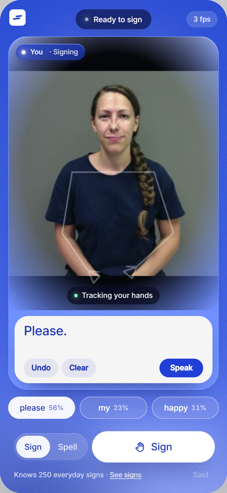

# SIGNLAYER web app

**Hear anything. See it signed.** The installable web app (PWA): tap to listen, and an AI signer card signs what it hears with live captions. The other direction, **Sign to speak** (`#/sign`), reads signs from the camera and speaks them. Vite + React + TypeScript, built on the shared contract in `../core` (`@signlayer/core`).

| Home | Live (signing) | Done | Light |
|---|---|---|---|
|  |  |  |  |

Design principles, tokens and motion specs: [docs/DESIGN.md](docs/DESIGN.md). `node scripts/shots-2030.mjs` re-captures every screen in light + dark at phone and desktop sizes and traces playback seams.

## Quickstart

```bash
node app/server/index.mjs            # the sign API on http://localhost:8787 (from the repo root)
cd app/web && npm i && npm run dev   # http://localhost:5173
```

No server yet? `npm run dev:mock` serves a toy `/api/sign` plus the real clips from the Vite dev server itself (clips folder: `CLIPS_DIR`, else `out/realtime/clips`, else `../sign-avatar-b-puppet/out/realtime/clips` next to the repo).

| Command | What |
|---|---|
| `npm run dev` | dev server, API at `VITE_API_URL` (default `http://localhost:8787`) |
| `npm run dev:mock` | dev server + mock API on the same origin |
| `npm run build` | typecheck + production build to `dist/` (with the service worker) |
| `npm run typecheck` | `tsc` for the app and the Vite config |
| `npm run sign-test` | fake-camera end-to-end test of `#/sign` (see below); also saves `docs/sign-home.png`, `sign-tracking.png`, `sign-result.png` |
| `npm run shots` | headless Chrome types "Thank you, see you later." and saves `docs/home.png`, `live.png`, `done.png` (needs a running dev server; `APP_URL`, `TEXT`, `MID`, `CHROME`) |
| `node scripts/shots-2030.mjs` | every screen in light + dark, 390x844 and 1440x900, to `docs/2030-*.png`, plus a seam trace of typed signing (`APP_URL`, `ONLY`, `THEMES`, `SIZES`, `DPR`, `REC=1`) |

**API base:** the gear on the home screen sets the server URL (saved in localStorage). On a phone, use your computer's LAN address (`http://192.168.x.x:8787`) and start Vite with `--host` (on by default here). The order is the settings field, then `VITE_API_URL`, then `http://localhost:8787`.

## How it works

- **Listening** uses the Web Speech API (`webkitSpeechRecognition`, continuous, interim results, en-US). Interim words show under the big wave (and later in the captions, faded); each final phrase goes to `POST /api/sign` and its playlist is appended to the running queue. Phrases are appended in spoken order even if responses come back out of order.
- **Type to sign** is always there ("Type instead" on home, "Type" on the live screen). It is the only input on browsers without speech recognition (Firefox, Safari as a home-screen PWA). If the mic is blocked, a banner explains how to allow it and offers Retry.
- **Gapless player** (`src/lib/player.ts`): two stacked `<video>`s. The next clip preloads in the hidden one; on `ended` it starts and moves to the front on its first presented frame. Every clip starts and ends in the same neutral pose, so they join seamlessly. Clips are fetched once into `blob:` URLs, so a swap never waits on the network. In testing, the longest frozen stretch was about 20 ms.
- **Captions** come from `captionFrame()` in core: heard, then signed, with a gliding highlight on the word being signed and the "Signing X for “word”" line. Words without a clip stay muted and dotted ("Can't sign yet"). Names the translator would fingerspell show "Fingerspelling not available yet". Nothing is ever faked.
- **Lanes:** one speaker card by default (`<Lane>` supports N speakers: lit, quiet and unseen states, one colour per speaker from `tokens.speakers`).
- **PWA:** `public/manifest.webmanifest` (cobalt theme, mark icons), and `public/sw.js` caches the app shell only, never `/api` or `/clips`. It also has iOS meta tags and safe-area insets. The service worker registers only in production builds (`npm run build && npm run preview`).

## Sign to speak (`#/sign`)

| Home entry | Tracking (recording) | Result |
|---|---|---|
|  |  |  |

- **Camera:** `getUserMedia` front camera at about 640×480, shown in the frosted card (mirrored by CSS only; the landmarks come from the unmirrored frame, as `core/landmarks.ts` requires).
- **Tracking:** MediaPipe `@mediapipe/tasks-vision` **HolisticLandmarker** in VIDEO mode (`src/lib/holistic.ts`), loaded lazily: wasm from jsdelivr at the installed package version, model `holistic_landmarker/float16/latest`. GPU delegate, CPU if WebGL is a software rasterizer or GPU init fails (`?delegate=cpu|gpu` forces one). One detection per presented frame (`requestVideoFrameCallback`, rAF fallback). A light pose + hands overlay and the live fps are on screen.
- **Segmenting** (`src/lib/segmenter.ts`): tap **Sign** to arm. When the hands appear it keeps a short pre-roll; when they move, recording starts. It stops when the hands are gone or still for ~0.5 s (and at least 2 frames), after 4 s, or on a second tap. Frames go through `packFrame` → `packSegment` → `client.recognize(mode, body)` (`POST /api/recognize?mode=sign|spell`). Space bar = Sign.
- **Result:** top-3 chips with confidence, the first one chosen; tap another to swap. Each sign is added to the sentence; **Spell** mode adds the fingerspelled word as `#WORD`. The sentence is `composeSentence(labels)` (no model call), shown in the caption sheet and **editable**; Undo, Clear, **Speak** (`speechSynthesis`, en-US). The last 8 spoken sentences are under "Said".
- **Honest limits on screen:** "Knows 250 everyday signs" with a **See signs** sheet (the Kaggle GISLR vocabulary, `src/lib/vocab.ts`), and a hint when the top guess is under 40%.
- **Errors:** camera blocked / missing (banner + Retry), hand tracking failed to load, recognizer offline (503, or `recognizer: "down"` in `/api/health`), server without `/api/recognize` (404), server unreachable.
- **Embed:** `#/sign?embed=1` (no home button, full-bleed) for the phone app's WebView. Every sentence change posts `{type:"sentence", text}` and Speak posts `{type:"speak", text}`: as a JSON string to `window.ReactNativeWebView.postMessage`, and as an object to `window.parent.postMessage(…, "*")` when framed. Embedded, it doesn't speak itself (the app does).
- **Serving at `/app/`:** the build uses `base: "./"`, so `app/server` can serve `dist/` at `/app/` (`http://<host>:8787/app/#/sign?embed=1`). Served there, the API defaults to the page's own origin.
- **Mock:** `npm run dev:mock` also mocks `POST /api/recognize` (it cycles hello, where, water, please, thank you… with plausible scores; it does not look at the landmarks). `MOCK_RECOGNIZER=down` returns 503.

### Fake-camera test

```bash
# a WLASL clip as a 640x480 30 fps webcam (1 s still before, 2 s after)
ffmpeg -i hello.mp4 -vf "scale=640:480:force_original_aspect_ratio=decrease,pad=640:480:(ow-iw)/2:(oh-ih)/2,fps=30,tpad=start_duration=1:stop_duration=2:start_mode=clone:stop_mode=clone,format=yuv420p" hello.y4m
npm run dev                                   # real recognizer behind app/server (or npm run dev:mock)
CLIPS="hello=hello.y4m,please=please.y4m" npm run sign-test   # EMBED=1 also checks the WebView messages
```

Chrome runs headless with `--use-fake-device-for-media-stream --use-file-for-fake-video-capture=<clip>.y4m`, opens `#/sign`, presses Sign and reads the top-5. Results on 2026-11-15 against the real recognizer (WLASL clips, signers not in GISLR training; one press per run, a laptop busy with other jobs):

| Clip | Top-5 (rank of the right sign) | Frames sent |
|---|---|---|
| please | please 0.89 / 0.60 / 0.83 / 0.56 (rank 1, four runs) | 5–10 |
| thank you | thankyou 0.71 (rank 1); a second run: wait 0.23, thankyou 0.12 (rank 2) | 6 |
| water | water 0.08 (rank 1, low confidence, hint shown) | 6 |
| where | up 0.13, where 0.10 (rank 2) | 4 |
| hello | cloud 0.66 … (not in top-5); a second run: cloud, sun, hello 0.07 (rank 3) | 8–13 |

So 9 of 10 runs had the right sign in the top-5, 6 of 10 at top-1. **The weak point is the frame rate here:** HolisticLandmarker took ~300–550 ms per frame in headless Chrome on this laptop (Iris Xe, GPU delegate; CPU delegate was slower, ~1–1.5 fps), so only **2–5 fps** and 4–13 frames per sign, where the recognizer was trained on ~30 fps video. A real camera on a free machine should do much better; the fps is on screen so you can see it. Recognizer round trip was 0.3–1.2 s (inference 12–99 ms).

## Not done / limits

- The mic path needs a real browser with a microphone (Chrome/Edge; it sends audio to the browser's speech service). It can't be tested headless; the denied-permission banner was checked.
- No speaker diarization: everything goes into Speaker 1.
- The browser extension card on home is informational (see `app/extension`).
- Sign to speak: one sign per tap (no continuous signing yet). Holistic runs on the main thread; a worker would keep the UI smoother on slow devices. Anything outside the 250 signs comes out as the nearest of them, which is why the guesses stay visible and editable.
