# Flux web, 2030 design

Calm, minimal and fast. The signer is the hero, and everything else gets out of the way.

| | Phone, dark | Phone, light | Desktop, dark |
|---|---|---|---|
| Home | 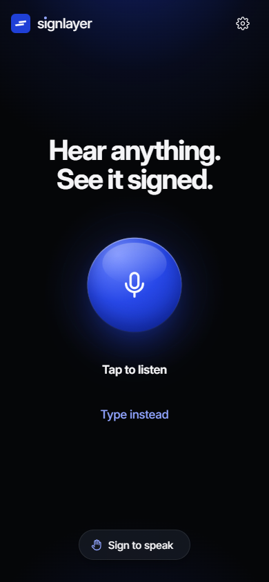 | 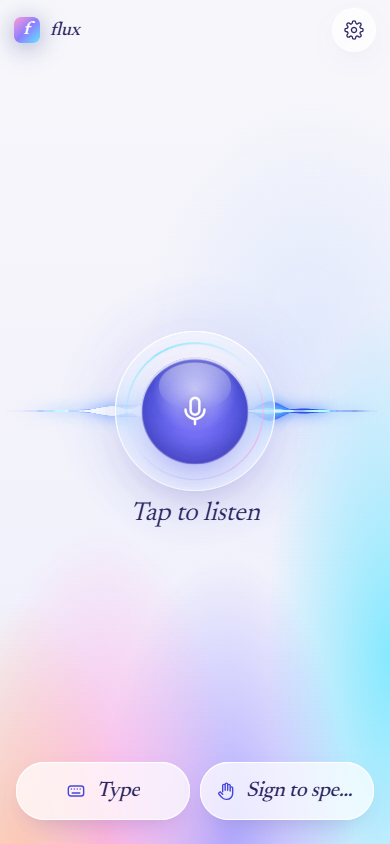 | 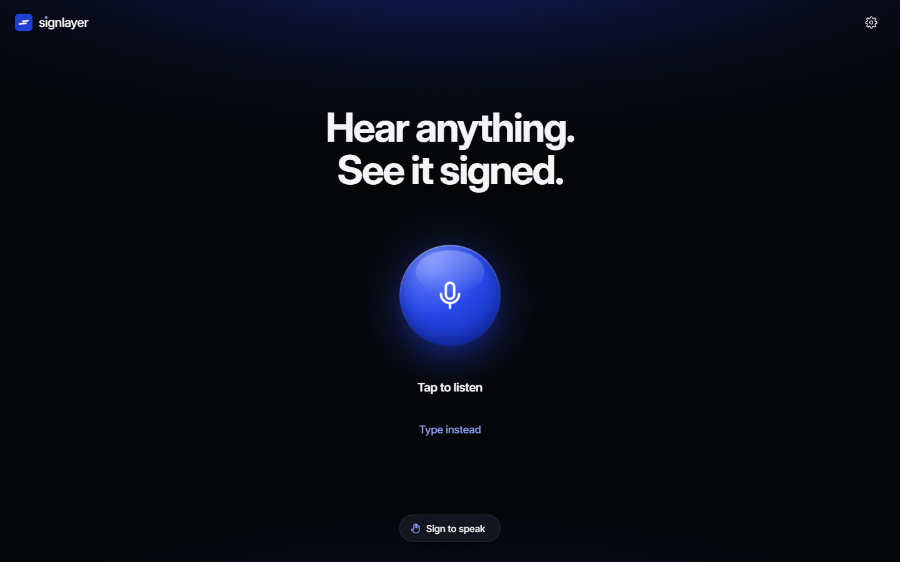 |
| Listening | 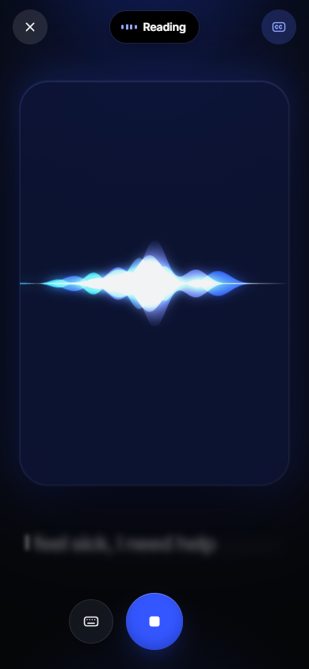 | 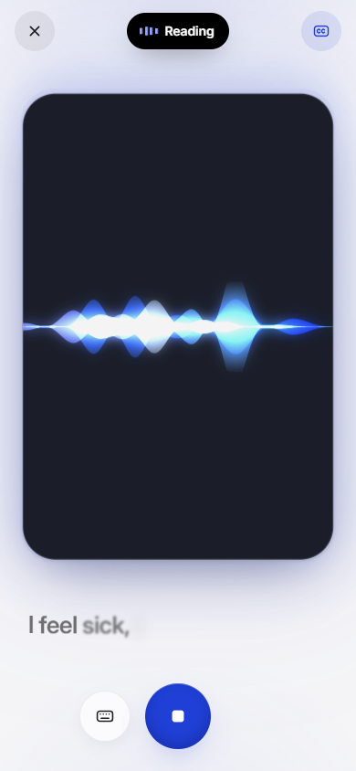 |  |
| Signing | 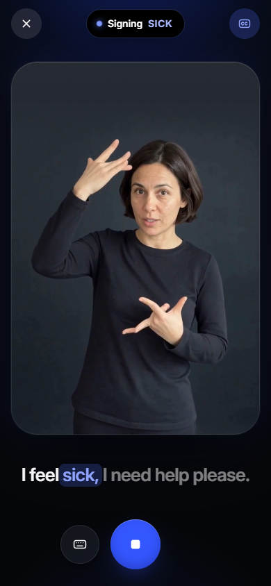 | 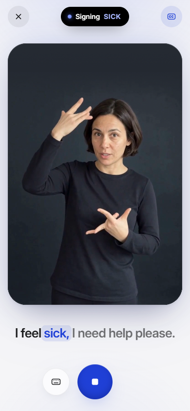 | 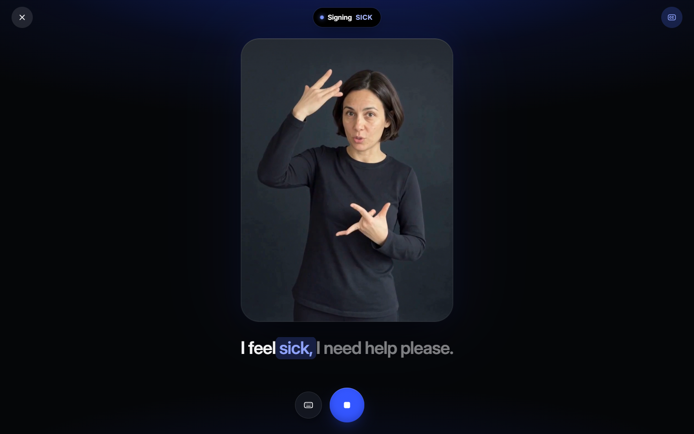 |
| Done | 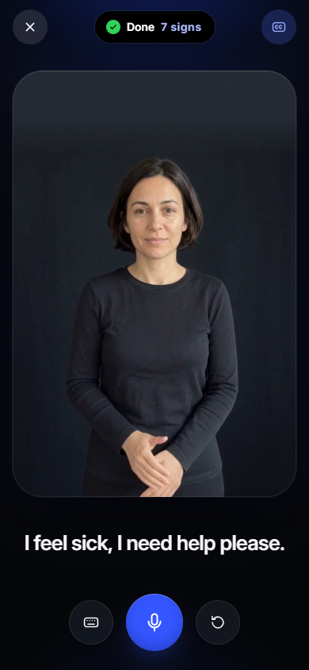 | 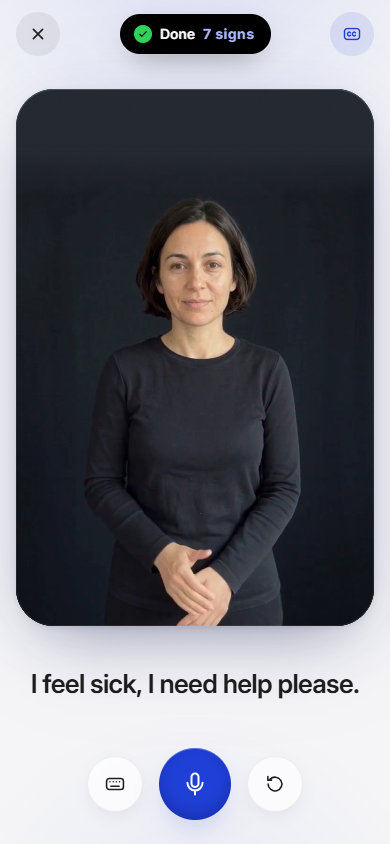 |  |
| Sign to speak | 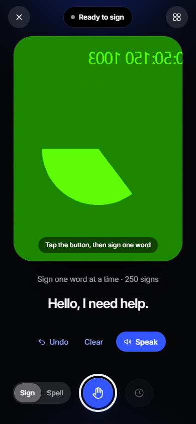 | 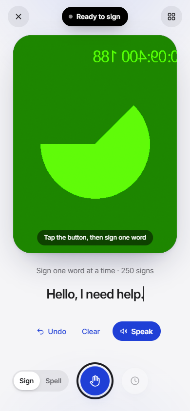 | 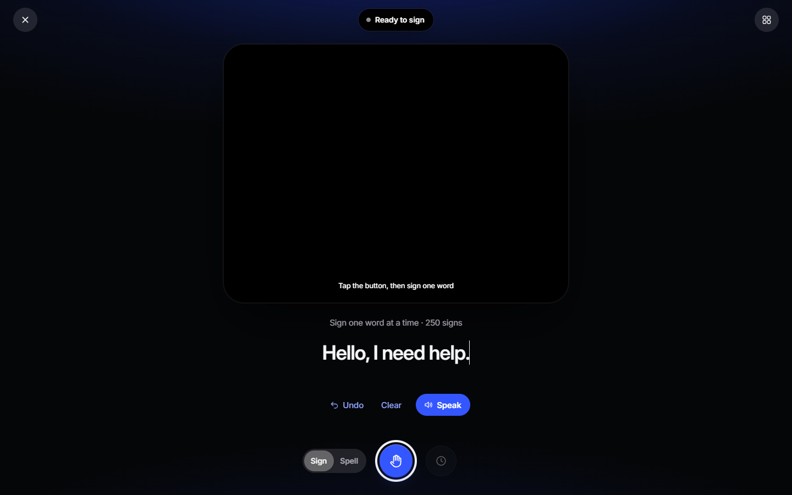 |
| Settings | 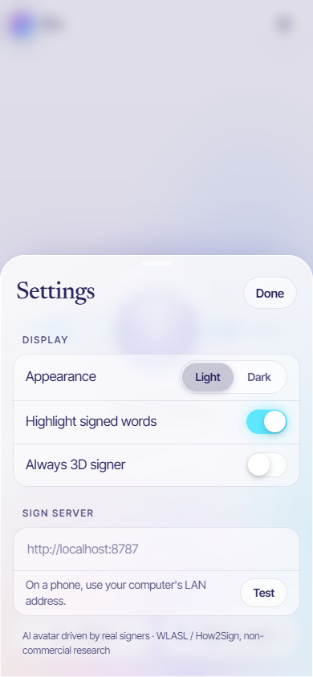 | 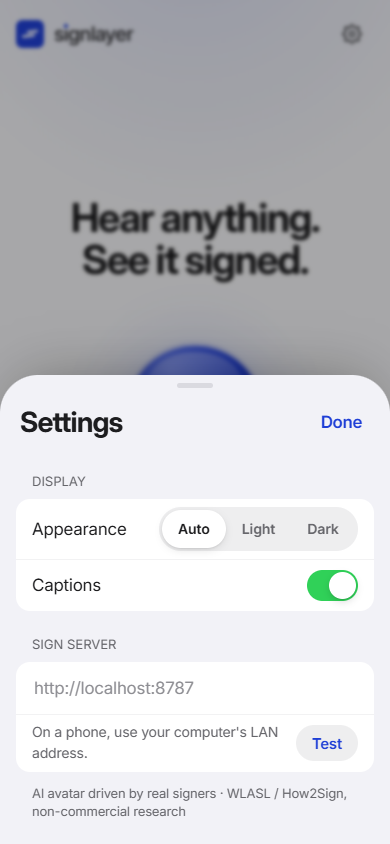 |  |

Every capture also exists in the other theme and size (`2030-<screen>-<phone|desktop>-<dark|light>.png`). Phone-only captures cover the edge cases: `hints` (words with no sign yet), `offline` (server unreachable) and `nospeech` (no speech recognition, so typing is the way in). To regenerate them, run `npm run dev`, then `APP_URL=http://localhost:5173 DPR=1 node scripts/shots-2030.mjs`.

## Principles

1. **One primary action per screen.** Home has the listen orb. Live has Stop, which becomes Listen again when signing is done. Sign to speak has the shutter. Everything else is quiet: a ghost button, a text button or a capsule.
2. **The signer is the hero.** On Live, the card takes all the height that is left. It shows the whole 3:4 clip, so the head and both hands are always in frame. It sits on the clips' own studio backdrop, so it never flashes black. Captions are set large under the card, with no box around them.
3. **Materials, not decoration.** Backgrounds are a soft paper (light) or near-black (dark), with one calm cobalt glow at the top. Controls are frosted material with a hairline edge and layered soft shadows. Grain is barely there (3.5 to 5 % overlay).
4. **The island narrates.** One black capsule at the top tells you what is happening: Listening (with live level bars), Reading, Translating, Signing + the gloss, Done + the count, Caption only, Offline, Recording. It morphs: its width springs and the label cross-blurs. Nothing else repeats this status.
5. **Motion is physical and quiet.** Springs, not durations. Elements move only on transform and opacity. Nothing shifts the layout: typed words that are not yet heard hold their place invisibly. Reduced motion gets instant changes.
6. **Less text.** No sub-headlines, credits or "Speaker 1" chips on the main screens. Attribution and the server address live in Settings.

## Tokens (`src/styles.css` `:root`)

| Token | Light | Dark |
|---|---|---|
| `--bg` | `#f5f5f7` | `#050608` |
| `--label` | `#1d1d1f` | `#f5f5f7` |
| `--label-2` (secondary, ≥ 4.5:1) | `#66666b` | `rgb(235 235 245 / .64)` |
| `--accent` (fills, white text 7.6:1 / 5.4:1) | `#1f3fd6` | `#3355ff` |
| `--accent-text` | `#1f3fd6` | `#8fa3ff` |
| `--material` | `rgb(255 255 255 / .72)` + blur 24 px, saturate 180 % | `rgb(30 32 40 / .58)` + blur 24 px |
| `--glow` (aura, halo) | `rgb(31 63 214 / .32)` | `rgb(51 85 255 / .5)` |
| `--cap-heard` (heard, not yet signed) | `.62` | `.5` |
| `--stage-top/bot` (clip backdrop) | `#252a32` / `#1b1f28` | same |

- **Brand:** cobalt `#1f3fd6`, the mark (cobalt tile, white bars) and the `flux` wordmark (Inter 500, with the dot in the accent).
- **Type:** `-apple-system, "SF Pro Display/Text", Inter (variable, optical sizes), system-ui`. Large titles are 40/64 px, 700 weight, −0.038 em tracking. Captions are 26/36 px, 600 weight, −0.024 em, 1.24 line height. Body text is 17 px, −0.011 em.
- **Spacing:** 8-pt grid (`--s1` 4 px through `--s8` 64 px). Every hit target is at least 44 px. The primary button is 72 px and the shutter is 76 px.
- **Radii:** 14 / 22 / 30 / 38 px. Cards use 38 px and capsules are fully round.
- **Appearance:** automatic through `prefers-color-scheme`. Settings → Appearance can pin it with `<html data-theme>`, and `meta theme-color` follows.

## Motion specs

| Name | Curve | Settles | Used for |
|---|---|---|---|
| `--spring` | critically damped (ζ 1, ω 16), sampled into `linear()` | ~580 ms | screen enters, captions roll, sheets |
| `--spring-snappy` | ζ 0.82, ω 20 (about 1 % overshoot) | ~430 ms | caption highlight, segmented thumb, switch |
| `--spring-bouncy` | ζ 0.62, ω 16 (about 8 % overshoot) | ~640 ms | island width, card arrival, button release |
| press | `ease-out`, 120 ms, scale 0.88–0.94 | | every button (a haptic-like squeeze) |

- **Screen changes** use the View Transitions API (`lib/motion.ts`). The old screen blurs out in 220 ms and the new one blurs in on `--spring`. The island has its own `view-transition-name`, so it morphs in place between Live and Sign to speak.
- **Island:** the content width is measured, the width animates on `--spring-bouncy`, and the label enters with a 5 px blur, a 0.9 scale and fades in over 420 ms.
- **Captions:** words enter from an 8 px blur and a 0.18 em drop. A heard word sits at `--cap-heard`, and a signed word is solid. The highlight is a soft accent pill that glides on `--spring-snappy` and moves on the frame where the clip appears.
- **Aura and halo:** one rAF loop (`lib/useLevel.ts`) writes `--level` (0..1) only on `[data-level]` elements. While the mic is on, the level is the real mic level from Web Audio (an RMS meter with fast attack and slow release). Typed text gets a speech-like synthetic level, signing gets a slow breath, and the loop stops once done. The halo is a box-shadow, so only transform and opacity change per frame.
- **Signing seams** (`lib/player.ts`): two stacked videos. `requestVideoFrameCallback` watches the playing clip and starts the preloaded next clip 140 ms before the end. The new clip comes forward on its first presented frame and fades in over 120 ms on top of the old one, which stays opaque underneath and holds its last frame. The outgoing element is reused for the next clip only after it is covered. The result is no black frame, no flash and no freeze at a seam. With reduced motion it is a hard cut on `ended`.
- **Reduced motion:** all animations and transitions drop to 1 ms. View transitions are skipped, the player hard-cuts and the level is static.

## Accessibility

- Text contrast is at least 4.5:1 in both themes, including heard caption words. Placeholders and disabled controls are the only exceptions.
- Focus rings are 3 px in the accent colour. Every icon button has an `aria-label` and a `title`.
- The island is a `role=status` live region. The Done summary is announced through a visually hidden line.
- The captions toggle is in the Live top bar and in Settings, and the setting persists.
- Escape closes Live and sheets. Space works the shutter on Sign to speak.
